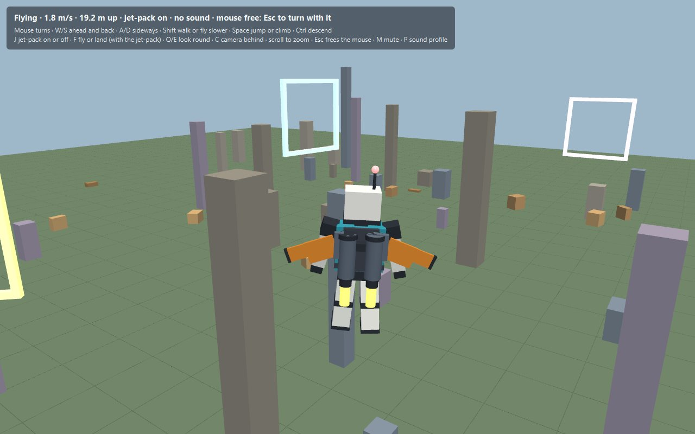

# avatar-demo — a box-rig avatar in plain JavaFX 3D

A standalone experiment: a small robot built from boxes that walks, runs and jumps around a
world of pillars, crates and floating gates, followed by a chase camera. Put on its jet-pack
and it flies as a drone does: upright, tipped gently toward where it goes, holding its place
when let go. Everything is heard as well as seen. Two sound profiles give the same world two
characters. Three separate benches are for working on the sounds (one for all of them, one for the
engines, one for the Gatling guns), and a fourth on the vehicles' models.



- **No mesh or skin.** Each limb is a rigid part hung from a joint. The animation is worked
  out each frame from how the body moves, the way blocky game characters are animated.
- **A solid world.** The avatar slides along what it runs into, stands on top of blocks,
  jumps up onto the lower crates (try the staircase straight ahead of the start), falls off
  edges, and lands on pillars it flies down onto. The layout (`Course`) is plain data that is
  both drawn and collided with, so what you see is what stops you.
- **Ramps.** A block's top can slope (`Block.ramp`): what stands on it stands on the slope where
  it is, rounds meet the slope, and its high sides are walls. The robot runs up a ramp on its
  feet and down one without a hop: on its feet, it keeps its footing on a surface falling away
  under it, a slope or a ledge no higher than a step. The flyover demo has a road across the way
  ahead of the start, up a ramp of one in four, over a deck 4 m up, and down the other side,
  with room to run under the deck; and further on, a ramp on its own to leap off.
  The playground has two flyovers of its own: one behind the start, carrying a road across over
  a street that runs out from the start under it, and another off to the right, carrying a road
  over a street running out east. The crates and pillars that were scattered where the roads run
  are cleared away; everything else is where it was.
  And everything since is in it too: down the street behind the start, the four vehicles parked
  two each side of it, the roadster and the van on its west side, the pickup and the truck on
  its east; out west, the bunker with its heavy Gatling gun;
  and off to the east, behind the start, an airship moored low to be boarded and flown, bombs and all, beside
  the three that sail their routes overhead.
- **Land vehicles: a bare chassis.** What a car or a truck is built on (`Course.Chassis`): a flat
  bed on wheels, a steering wheel on a column, and nothing else yet. The car's is 4 m long on four
  wheels; the truck's 7 m on six, its back four on two axles together. Stand beside the driver's door (or at the
  steering wheel, on a bare chassis): T gets in. W speeds it up, S brakes and then reverses, A and D steer,
  Space is the handbrake, Shift goes gently; the mouse does not turn it. Only the front wheels
  steer, so it turns about its back wheels, as racing games have it, the less sharply the faster
  it goes. Each wheel finds the ground under it: it drives up and down ramps and over the
  flyover, tipped as the slope is, leaps off a ramp's head, and stops dead against anything
  standing higher than a kerb. The driver sits in a seat behind the steering wheel, kart-fashion,
  its legs out ahead and its hands on the wheel, and is carried with it.
  Low on the right, as racing games have them, its instruments: a round tachometer, its needle
  sweeping up toward the red line (6,500 for a V6, 6,000 for a V8) and dropping back at each change
  of gear; the gear, big, in the middle of the dial, R going back; and the speed in km/h under it.
  Each is a vehicle of the engine bench's (`Vehicle.of`), and goes as it does: its real top
  speed, as its engine, its gears and the air make it there (the car about 249 km/h, the pickup
  limited to 185, the truck to 120, the scooter 97, the sport bike 236, the cruiser and the boxer 182), and
  getting up to speed as it does, briskly from a standstill, less and less so as it nears its top,
  as quick as on the bench to make most of it (`Course.Drive.accelAt`). Its gearbox (`Gearbox`) is
  the bench vehicle's too, the same gears, final drive and wheels (`Vehicle.rpm`): at any speed,
  in any gear, the same revs as on the bench. Six gears in the car and the pickup, eight in the
  truck. It changes by itself, as a quick automatic does: up near the red line pulling hard, up
  early cruising (a car at 90 km/h in sixth, under 2,000 rpm), down as it slows, down a gear or
  two flooring it; the throttle cut for a moment at each change, blipped going down; the clutch
  slipping pulling away. On a cross-slope, a banked turn, a land vehicle rolls as the ground
  under its left wheels and its right does, its driver rolled with it (`Lift.roll`).
- **The track.** A NASCAR-style oval, a demo of its own (`Course.trackDemo`), in a world now
  900 m across: two straights of 400 m and two turns of 120 m radius, 24 m wide, about 1.55 km
  round, like a one-mile oval. Flat all round for now: banked turns (`Course.TRACK_BANK`, the
  banking easing in and out over the first and last fifth of each turn) wait on vehicles settling
  well on uneven ground. A concrete wall all round its outside, a paler apron round its inside, a
  white line across the front straight to start and finish at, pit road inside the front
  straight, and grandstands outside it. Every land vehicle stands on pit road, heading the way
  they race, round to the left: the roadster, the van, the pickup, the truck, the scooter, the
  sport bike, the cruiser and the boxer. Driven flat out, the roadster laps it from a standing start, at
  240 km/h down the straights.
  The car carries a heavy Gatling gun fixed to the right of the seat: it does not turn on its
  own, but fires the way the car faces, tipped up or down with it on a ramp, and whoever drives
  fires it with a click (a weapon in the hands stays quiet meanwhile). This is the other way a gun
  is held: moving with what holds it, as the hands hold theirs, rather than aimed freely on a
  mount (`Course.Mount#fixed`).
  The pickup (5.2 m, four wheels) has its seat well forward, and on a post at its back, high
  enough to fire over the driver's head, a heavy Gatling gun aimed freely: what a pickup with a
  gun, or an armoured vehicle, is built on. T at its door takes its wheel, and its gun with it
  (gun control): the keys drive it, A and D steering as ever, and the mouse aims the gun all
  round, 10° down and 45° up, a click firing it; the gun holds its aim on the world as the
  pickup turns under it. The view stays the pickup's, behind it, the gun's sight marked where it
  points. G gives the gun up, and the pickup is driven as any car is; G again takes it back.
  Crates stand about behind the start, to turn it on.
- **Bodies.** On the Roads demo each chassis wears a body: the car a low open roadster, blue; the
  truck a square cab over its front wheels and a flatbed, orange; the pickup a cab with a sloping
  windscreen and an open bed round its gun, red; and a van on the car's chassis, cream, tall and
  boxy, its windscreen glazed before the driver and open on the right as a port for the car's
  fixed gun, its sides glazed behind the driver's door, and a hatch at the back. Every body has
  bumpers, headlamps and tail lamps, and the view rides over its roof. A body is sheets of metal and glass, drawn by a
  renderer of their own (`Sheets`): each sheet a flat panel of any outline, hollows and all, as
  thick as it is, seen from either side; built from a side profile pushed out across the body,
  outlines at its sides, and single panels (`Bodies`). Rough for now, flat and few, but finer
  shapes are only more sheets. To the world a body is nothing but how the vehicle takes harm
  (`Course.Bodywork`): its armour makes it tougher, and its plating takes something off every
  blow; and its solid boxes, a rough match for its panels (the van one tall box, the pickup a
  cab and its bed's sides), are what rounds strike and what bumps into it, the chassis's own
  parts and the body's together. With the body round the seat, a vehicle is got into from the
  ground beside the driver's door (T), and let out there; at the wheel, the driver sits still in
  it, carried.
- **Collisions.** A land vehicle running into something that gives, a crate or another
  vehicle, collides with it as their masses and speeds say (`Play.collide`): every vehicle has
  its mass, its bench vehicle's (`Course.Drive.mass`: the car 1,450 kg, the pickup 2,100, the
  truck 6,500, the bikes 195 to 395 with their riders), and every loose thing its own
  (`Loose.mass`). The push between them is along the line from one's middle to the other's,
  momentum kept, and they part a little (bounce 0.2). A truck shoves a crate on, hardly slowed;
  a car running into the parked truck stops short and barely moves it; the truck running into
  the parked car sends it off at about the truck's own speed. A vehicle shoved rolls on ahead,
  and shoved sideways its tyres scrub that off hard. Kept on the throttle against a crate, a
  vehicle pushes it along ahead of it. The energy a collision takes out of the two, past a
  gentle push's 1.5 kJ, harms them both, a crash blow (`Weapon.CRASH`) each for every
  kilojoule: the pickup at 50 km/h breaks a crate, and is dented. What does not give, a wall, a
  pillar, a ramp's side, stops it dead, as ever.
- **Two-wheelers: a scooter and motorcycles.** The same chassis, on two wheels in line under a
  narrow frame, with handlebars over the front wheel on raked forks (`Course.Chassis`,
  `twoWheels`): a scooter, small-wheeled, teal, its engine under a cowl beneath the seat, a
  floorboard for the feet and a shield before the legs; a sport bike, red, its nose fairing, a
  tank to tuck down over, a raised tail and a pipe out the back, the quickest of everything that
  drives; and a cruiser, long and low, dark blue, a teardrop tank, its V-twin's two cylinders
  standing out of the engine, fenders over both wheels and long chrome pipes down the right;
  and a big boxer cruiser, black, a long tank, its boxer twin's two great cylinders lying flat,
  standing out to either side ahead of the rider's knees, a pipe down each side, heavy and steady;
  built, as a real motorcycle is, on a frame of steel tubes, a double cradle, its swing arm the
  shaft's housing (see the [vehicle bench](#vehicle-bench)).
  Got onto from beside them (T), ridden as a car is driven, and got off again there. The rider
  sits astride, as the bike has it: upright on the scooter, feet forward on the floorboard;
  tucked over the tank on the sport bike; sat back on the cruiser, feet out ahead, arms out to
  wide bars; upright on the boxer, feet forward, knees wide round its cylinders. Each leans into its turns as a rider would lean it to balance going round
  (`Lift.lean`): the harder the faster it goes round, at most 45°, upright going straight, the
  rider leaning with it about where its tyres touch the ground; only how it is shown, to the
  world it stands as ever. Each has its engine from the engine bench: the scooter a 125 cc
  single on a CVT, which holds it most of the way up its revs as the speed builds (D on the
  dial); the sport bike a 90° L-twin with six gears, changed in a flash; the cruiser a 45°
  V-twin, its uneven beat, with five; the boxer a 1.8-litre boxer twin, its two cylinders firing a
  turn apart, evenly, into a pipe each side, a deep, even thrum, lazy to rev and done by 5,750, with
  six gears. They stand behind the start on the Roads demo, and along the street on the playground.
- **A sidecar outfit.** The boxer with its sidecar clamped on its right (`Course.BOXER_SIDECAR`):
  its sidecar's tubes, a tub on them with a seat, and its wheel; got onto from the left, away from
  the sidecar, and ridden as the boxer is, but heavier (496 kg) and slower (about 161 km/h flat out),
  its engine and gears the boxer's own. On three wheels, it does not lean. Going round, it is held
  against its table of the sharpest it may be steered at its speed (`Outfit`, as on the
  [vehicle bench](#vehicle-bench)): toward the sidecar it is soon too much (at 30 km/h, about three
  degrees of steer), and the chair lifts, the outfit heeling away from it; past the limit for a
  quarter of a second, it goes over on its left side, the sidecar in the air, with a thud, throwing
  its rider off, and lies there, still, until T beside it rights it. Away from the sidecar it
  holds. Its bars are turned gently, the more so the faster it goes, by the same table: toward the
  sidecar they take half a second to come round to the sharpest it may be steered at its speed
  (about 6° a second at 30 km/h, under 2° at 60), and go no further than 1.6 times that, so held
  over it still lifts the chair and goes over, but a touch of the key does not; away from it, they
  go no further than just short of its limit that way, the tyres sliding long before it would tip
  so; and let go, they come back three times as fast, to catch a lifting chair. It stands with the
  other bikes on the Roads demo, the playground and pit road.
- **An ice cream cart outfit.** The same boxer and sidecar frame, wheel and all, carrying an ice
  cream cart in place of the tub (`Course.BOXER_ICE_CREAM`, `Sidecar.Body.ICE_CREAM_CART`): a white
  freezer, a pink stripe and a sky blue one round it, two chrome lids on top, a pink and white
  striped umbrella over it on a pole, and a great cone of three scoops on its front for a sign.
  Heavier still (556 kg) and slower (about 147 km/h); the cart is ballast out over the sidecar's
  wheel, so it takes more to lift (0.36 g toward it, against the tub's 0.22 g; at 40 km/h nearly
  three degrees of steer, not under two), and less to tip the other way (1.19 g), still more than
  the tyres hold. It is ridden, tipped and righted as the tub outfit is, and stands beside it on
  the Roads demo, the playground and pit road.
- **A bunker with a heavy Gatling gun.** A concrete pillbox, its gun on a pedestal behind a slit
  along its front. Walk up to the door at its back and press T to man it: the robot is inside, out
  of sight, and the view is the gunner's, from just behind the gun, looking out through the slit.
  The gun is aimed freely, not by turning the robot (`Turret`): the mouse swings it round, 55°
  either way, and up and down, 8° down to 25° up, no faster than 70° a second, as a heavy
  thing turns. Click fires, as every gun fires (`Gun`): held, its six long barrels spin up over
  1.2 s, then it fires 30 rounds a second, each five times the hand-held Gatling gun's, for as
  long as it is held (a mount can be made to overheat, but neither gun does for now). Its rounds
  go out through its own bunker. Wreck the bunker (it takes 2500) and the gunner is thrown out. T
  again steps out of the door.
- **Mounted guns.** A heavy Gatling gun on a pedestal, a seat behind it, bolted to the top of
  anything solid (`Course.MOUNTED_GUN`): to begin with, one on top of every pillar, facing out from
  the middle of the world. Fly up and land behind one: T sits down at it. It is worked by the keys
  alone (`Course.Mount#keyed`): A and D run an electric motor that turns it all round, without
  stops, at a steady 60° a second, the seat turning with the gun and carrying the gunner round
  with it; W and S raise and lower it, 30° down to 75° up, its hydraulics easing it smoothly to
  where the keys have asked (`Course.Mount#ease`). Space, or a click, fires it. The view is from
  behind and over it, tilting with it. T again gets up, standing on the pillar where the seat had
  turned to.
- **A jet with swing wings.** Avatar and pack are drawn as a fighter jet standing on its
  tail, held up by the thrust of its twin engines. The wings lie in the plane of the back and
  pivot there as a variable-sweep fighter's do. They are tucked along the engines on the
  ground, spread wide to hover, and swept further back the faster it flies. They are as solid
  as the body: a wing that meets a post stops the flight, and one that clips an edge glances
  off.
- **Weapons.** Two AK-style rifles, one in each hand, held from the hip as a soldier fires
  from it: each stock clamped between the upper arm and the body, the forearm folded along the
  rifle to the pistol grip. They fire in turn, left and right, each forearm kicking up as it
  fires, with a flash at the muzzle and a brass casing thrown out. Or a glaive as Guan Yu
  carried, a long pole with a broad crescent blade, standing upright in the right hand. Its
  strokes go in turn: a cleave over the head, then a sweep across. Or a Gatling gun with a
  motor, held at the right hip by its grip, the left hand reaching across to a lever on top.
  The left arm is worked out each frame to keep its hand on the lever wherever the gun points.
  Its six barrels spin up before it fires, 2,400 rounds a minute, and spin down when let go.
  The robot holds it dead steady, every round along one line, with a tracer every third round
  and casings pouring out.
- **Aiming and hits.** The rifles shoot straight ahead of the body, wherever the head or the
  camera is looking round: to aim, turn the body. Up and down follow the view instead: tilt it
  up from where it rests and the guns aim up as far, tilt it down and they aim down, up to
  50° either way for the rifles and 30° for the heavier Gatling gun. At rest, and walking, they
  shoot level. A crosshair out in the world marks the
  line the rounds fly along, where it meets a block or the ground, or 30 m off. It is only a
  mark: it never steers a round. Being in front of the avatar, it never hides it. Each round
  flies from its own muzzle, spread a little as rounds from the hip are, with a tracer. Where
  it strikes a block it throws sparks and leaves a bullet hole; on the ground, a puff of dust.
  The glaive strikes whatever is within its reach as the blade comes through. A cleave chops
  into the ground in front, and a sweep catches what is beside; on a block the blade leaves a
  gash. The marks fade after a while.
- **Targets and damage.** A range of wooden target dummies stands off to the left of the start,
  more behind it. (Drones are left off the maps for now: their model got in the way of the land
  vehicles. The kind, its looks and its sound are all still there, to bring back.) High over everything, far out, three great
  armoured airships go slowly round the start, a lap taking the best part of two minutes. Each
  is 18 m long, with a stepped steel hull banded in yellow, a cross of tail fins, a lit gondola
  underneath and an engine with a turning propeller either side. Each part of one is solid, so
  it can be landed on, and whatever stands on one is carried along with it, turned as it turns,
  and can walk about on it as it goes. They, and the crates, can be broken; pillars and
  gates stand whatever is thrown at them. Every round or stroke takes some of what a piece can
  take:
  - a rifle round takes 10, a Gatling round 8 (but 40 a second), and a stroke of the glaive 100;
  - a dummy can take 300, a drone 120, and an airship 3,000: most of ten seconds of the
    Gatling gun. A crate takes from about 90 to 600, by its size.

  As it wears down it darkens and cracks, and a bar over it shows what it has left. An airship
  catches fire instead, in more places as it nears its end. The blow that takes the last of it
  breaks it: a crate or dummy bursts into pieces that tumble, bounce and come to rest, and a
  drone goes up in a fireball. An airship goes up in blast after blast along its hull and rains
  wreckage from the sky. Broken is for good, until the demo starts again. It is gone from the world, so rounds fly on through where it stood and whatever stood
  on it falls. The HUD counts the targets down and the crates broken.
- **Bombs.** Each airship lets a bomb go every three seconds, in turn, wherever it is: carpet
  bombing. A bomb falls from under the gondola, carrying on the way the airship was going, and
  goes off at the first thing it meets, in a fireball, embers and, on the ground, clods of earth
  thrown up. Every crate or target within 3.5 m of it takes 150: a drone or a small crate goes at
  once, a dummy takes two. The robot takes no harm from them yet.
- **Platforms, flown like magic carpets.** Three steel platforms float just off the ground, edged
  in yellow and black, a thruster glowing under each corner and a console at the front: a
  small one, 3 m by 2.4 m, off to the right of the start, a broad barge, 10 m by 6 m, off to
  the left, and a meeting platform, 6.4 m by 5.2 m, further round to the left. A platform is as big as it is made for what it is for (`Course.Deck`). Jump onto
  one and stand behind its console, and the HUD offers the controls (T). At them, the keys that
  would move the robot fly the platform: W and S ahead and back, A and D sideways, the mouse
  turns it, Space climbs and Ctrl descends, from just off the ground to 350 m up, well over the tallest tower, climbing at 7 m/s, Shift to go
  carefully. It eases up to speed and to a stop, and stops short of anything in its way, with
  room over the deck for whoever rides it. The robot stands at the console and is carried and
  turned with it, and can still draw a weapon and fire. T again lets go, and it hangs where it
  is. F at the controls cuts its engine: its thrusters go dark, it cannot be flown, and it drops
  until it settles on whatever is under it (the ground, a crate or pillar, an airship, another
  platform, or the robot's head) and rests there. Resting on something that moves, it is
  docked: set one down on an airship and it goes round with it, the pilot aboard; set the small
  one down on the barge and it goes wherever the barge is flown. F again starts it, and it lifts
  off from there. Whatever moves (the airships, the platforms) is drawn where the simulation says it was at
  its last two steps, part way between, and marks on it go with it.
- **Vehicles.** The platforms and an airship to be flown are vehicles (`Course.Craft`): each
  handles as it does (`Course.Handling`), takes damage and breaks like anything else, and, at
  its controls, the camera is the vehicle's: it follows the vehicle from as far back as it is
  big. A platform is open: the robot rides it in plain sight. An airship is closed: walk in
  under its gondola, take it (T) at the hatch in its floor, and the robot is inside and out of
  sight, at its controls and those of the rapid giant Gatling gun in a ball turret hung under the
  gondola's back end: 30 mm shells, two and a half times as heavy as the heavy gun's, from seven
  barrels, 3,900 a minute, spun up in little more than half a second. W and
  S fly it ahead and back, A and D turn it (slowly, as an airship turns), Space climbs and Ctrl
  descends, never below its moorings; it has no sideways and its engines are never cut. The
  mouse aims the gun, all round, 80° down and 10° up, and the gun holds its aim on the world as
  the airship turns; a click fires it, spinning up first. The view stays the airship's, behind
  it. A and D steer it always, as a car's wheel would: it cannot go sideways. G gives the gun
  up, the mouse then left alone and a click dropping a bomb; G again takes it back. A right-click drops a bomb
  from under the gondola, going as the airship goes; held, a stick of them, one every 0.4 s. Its bay holds a dozen, and loads them back, one a second,
  when it is down at its moorings (no bombs are dropped there). Low over its own bombs, it takes
  their blast too. T again and the robot drops out of the hatch, from wherever it is. Broken
  while flown, a vehicle throws out whoever flies it. At a vehicle's controls the HUD is the
  vehicle's: how fast and high it goes, how much of it is left, its engine or its bombs, and
  its own keys in place of the robot's. Low on the left, a small control panel shows what can be
  done there, each with its key (the gun, a bomb, first person, the camera, getting out): free
  the mouse with Esc to click them.
- **The fruit stall.** On the barge stands a fruit stall: a table of planks on pallets under a
  red and white awning, a sign (西瓜), a scale, a row of striped watermelons and a few more on the
  deck, and three pineapples standing at the other end. The stallholder sits on a stool behind it; a customer stands before
  it, and another sits on a scooter parked to one side. All of it goes with the barge wherever
  it is flown, and standing on it rides too. Every piece of fruit is one kind of thing (`Fruit` says which, how big and how tough), to
  be shot or cut: a watermelon takes three rifle rounds, four of the Gatling gun or one stroke of
  the glaive, a pineapple two rounds. Struck, it splashes juice, red or gold, and the
  stallholder shakes a fist; burst, it throws its flesh and skin, seeds or leaves, with a wet
  splat, deeper for a watermelon, and everyone jumps, hands in the air. The HUD counts the fruit
  smashed.
- **Loose things: furniture, fruit and crates.** The crates are loose too (`Crate`): each as
  heavy as its planks, a hollow box at 18 kg a square metre of its sides, so a two-metre crate
  is about 450 kg. Too heavy to shove by hand, they stand where they are until a vehicle runs
  into one. The table and the fruit are loose things (`Prop`): each
  stands on whatever is under it (the deck, the table, the ground), and goes where that goes, so
  the fruit rides the table and the table rides the barge. Walk into one and push, and it slides
  the way you push it, as readily as it gives (`Loose#give`): fruit at your pace, the heavy table
  at under half of it; it slides to a stop, and stops short of anything in its way. Push one
  into another and you push both: a row of melons goes along together, front to back, heavier
  going the more there is (each one's give adds up as weights do), and a melon pushed against the
  table pushes the table; against a pillar, nothing moves. What stands on it goes with it: push
  the table and its fruit goes too. Pushed off an edge, or with what
  held it up broken, it falls; landing harder than it can take (`Loose#landing`), it breaks, so a
  watermelon dropped from three metres bursts while one off the table is fine. Furniture
  (`Furniture`) is broken like anything else: the table takes twenty rifle rounds or two strokes
  of the glaive, and what was on it drops to the deck. The stallholder's stool and the scooter
  are furniture too, and whoever sits sits on top of theirs: push the stool or the scooter and
  they ride along on it; push them, or break it, and they come off it to stand on the deck.
- **A stand-up in the air.** On the meeting platform, a scrum meeting is under way: five developers
  stood in a ring, each in a hoodie of their own, and the scrum master at its back, picked out at
  a glance in an orange hoodie and a red cap, a badge on a lanyard and a clipboard held before
  them. Behind them stands the team's scrum board on its legs, three columns, to do, doing and
  done, headed in grey, blue and green, the cards stuck up in them. Each developer has the floor
  in turn, five seconds each, talking with their hands; the others turn to whoever is talking,
  the scrum master furthest. Fly the platform (its console is at the front, clear of the ring)
  and the meeting goes with it, board and all. The board is furniture, to push or break; the
  team are people, as the stall's are. It is on the Flying platform demo as well.
- **People.** The people at the stall and the stand-up are characters in the world (`Person`), each
  with a body like the robot's: they stand on whatever is under them, ride their platform wherever it is flown,
  and fall. Walk into someone and they are shoved out of the way, sent along at your pace and a
  little more; shove them off the edge of the deck and they fall off. A push gets anyone sitting
  to their feet, and people pushed into each other part. Rounds, the glaive and bombs strike
  them: each hit knocks them back a little and they stagger. A fall hurts them too, the harder
  they come down the more: stepping off the barge at the ground does nothing, a fall of four
  metres costs a third of them, seven or more is the end. Six rifle rounds, a stroke of the
  glaive, a bomb nearby or a long fall, and they are destroyed: they blow apart in a puff of
  fire, in their own colours, and are gone. The HUD counts the people down.

## Build and run

From the repository root:

```bash
mvn -pl avatar-demo -am package
java -jar avatar-demo/target/avatar-demo.jar
```

It opens on a choice of demos: the **playground**, everything at once (the course, its targets and
airships, the flyovers, the four vehicles, the bunker, a gun on each pillar, an airship to fly and a gunship to fly), or one built round a
single vehicle, open and simple, so the vehicle is all there is to look at: the **flying
platform**, among a few pillars and gates, and the **airship**, moored by the start, with a yard of crates beyond it to
bomb; the **roads**, a flyover and a ramp, with a car's chassis and a truck's to drive on them; the **guns**: a bunker
with a heavy Gatling gun, a mounted gun on each pillar about, and crates and dummies out in front; the **track**, a NASCAR-style
oval to take every land vehicle round flat out; the **town**, every building put up along streets, the boxer
motorcycle to ride between them, a void deck part way up each tower with a bar and a melon stall on it, and before
them the melon stall and the stand-up, each on its platform; and the
**temple**, a courtyard before a great hall, a smaller hall each side, three monks at their stand-up in it; and the
**pyramids**, each in the way as it is shaped; and the **pavilions**, round a lawn, to walk into (`Demo`).
Click one or press its number. In a demo, the menu bar along the top has them too (Demo):
switch straight to another, or start this one again; with the view (first person, the camera
behind) and the sound (mute, profile) alongside. Tab comes back to the choice. Right clicks are
left to the game.
`-Davatar.demo=AIRSHIP` (or `PLATFORM`, `FLYOVER`, `GUNS`, `TRACK`, `TOWN`, `TEMPLE`, `PYRAMID`, `PAVILION`, `PLAYGROUND`) goes straight to one.

One self-contained jar carries JavaFX and the OpenAL libraries. The same jar opens the sound
bench with `--bench`, the engine bench with `--engine`, the gun bench with `--guns`, the vehicle bench with `--models`, the buildings bench with `--buildings`, the aircraft bench with `--aircraft`, or writes every sound to WAV files with `--sounds [folder]` (see
[Sound](#sound)).

## Controls

The mouse turns the avatar with no button held, as in games. The cursor is hidden and kept in
the window, so clicks stay free for actions.

| Key | On foot | In flight |
|---|---|---|
| Mouse | Turn | Turn |
| W / S | Ahead, back | Ahead, back |
| A / D | Sideways, without turning | Sideways |
| (no Shift) | Run | Full boost |
| Shift (held) | Walk | Cruise |
| Space | Jump | Climb |
| Ctrl | | Descend |
| J | Put the jet-pack on, or take it off | Take it off (and fall) |
| T | Take a platform's controls, behind its console, a chassis's, at its steering wheel, board an airship, under the hatch in its gondola's floor, board the gunship, beside its cockpit door, or man a bunker's gun, at its door, or a mounted gun, behind it; or let go of them (step out). At them, W/S/A/D, the mouse, Space and Ctrl fly it, and F starts or cuts a platform's engine, or the gunship's | |
| F | Take off (wearing the pack) | Stop flying |
| Q / E (held) | Swing the camera round | Swing the camera round |
| C | Camera behind | Camera behind |
| Scroll | Zoom | Zoom |
| M | Mute or unmute | Mute or unmute |
| P | Next sound profile | Next sound profile |
| 1 | Draw the twin rifles, or put them away | Draw the twin rifles, or put them away |
| 2 | Draw the glaive, or put it away | Draw the glaive, or put it away |
| 3 | Draw the Gatling gun, or put it away | Draw the Gatling gun, or put it away |
| Left click (held) | Fire, or swing; at a vehicle's controls, fire its gun (aboard the airship with its gun given up, drop a bomb) | Fire, or swing |
| Right click (held) | Aboard the airship, drop a bomb (held, a stick of them) | |
| G | At the controls of the pickup or the airship: give up control of its gun, or take it back | |
| Esc | Free the mouse, or take it back | Free the mouse, or take it back |
| V | First person, or back: on foot, from the avatar's own eyes, exactly where its visor is drawn, so the view goes with its head into a run, a dive or a flight (its arms and what they hold drawn upright and steady at the bottom of the view, however it is tipped, the rounds still leaving from its hands); at a vehicle's controls, from the driver's seat | The same |
| Tab | Back to the choice of demos | Back to the choice of demos |

The gunship flies as an aircraft does (`Flight`), not as the platform does: it has momentum,
the air drags it, and its two big ducted rotors push only the way they point, so it tips to go
anywhere. It is parked on its wheels in the playground, beside the moored airship, its engine off:
T beside its door boards it, F starts its engine, Space lifts it off. The keys are what is wanted
of it, and its assist works out how to get there, as a fly-by-wire aircraft's does: W and S a speed
ahead or back (its nose dips to get going; as it speeds up its rotors tilt forward, up to 85°, and
its wings take its weight, to 50 m/s), A and D a speed aside (banking that way), Space and Ctrl a
rate of climb (settling gently onto its wheels near the ground), the mouse its heading (going
fast, banked round as an aeroplane turns, no faster than its bank allows). Let go, it pitches up,
tilts its rotors back to brake, and hovers where it is. With its engine cut it has no thrust and
drops. Its pitch, bank and rotor tilt are drawn as they are, and shown in the status line. It has
no weapons yet, and no sound of its own.

As in most shooters, it goes at full speed unless Shift is held. `-Davatar.pack=true` starts
with the jet-pack on. Clicks fire only while the mouse is captured, so a click to take the
mouse back never fires. Aim left and right by turning the body with the mouse, and up and down
by tilting the view with it; looking round (Q/E) does not move the aim.

## Sound

Every footfall is heard, on the ground or on a block, along with each jump, landing (as hard
as the fall), bump and gate flown through, the pack, and its wings swinging. So is every round from each
rifle's muzzle, every stroke of the glaive, and each weapon as it is drawn. The Gatling gun in
hand or manned is made as it turns and fires, shot by shot as the gun fires them, its motor
whining up and down with its spin, mixed realistically or as a film would (the Sound menu; see
[Gun bench](#gun-bench)); the Arcade profile loops its chip's whine and roar. What they strike
is heard where it is struck: a round on a block, ticking or ricocheting, or thudding into the
ground; the blade clanging off a block, or chopping into the earth. What breaks is heard where
it stood: a crate or dummy splintering and its pieces clattering down, deeper the bigger it
was, a drone blowing up, or an airship coming down in a chain of blasts with its frame
groaning. Explosions are loud all through, as a blast overloads a microphone, and carry: a
footstep is heard in full only within 3 m, a drone blowing up within 15 m, a bomb within 30 m, an airship coming
down within 60 m. For a moment each one pushes the rest down (the jets, the wind, the Gatling
gun's roar), as games mix them, so it punches through. The nearest airship still in the sky
drones from where it is, faint from the ground and loud alongside it. The vehicle being driven
  is heard from under its bonnet: a V6 in the roadster and the van, smooth and raspy, every third
  of a turn a cylinder firing; a V8 in the pickup and the truck, deeper, its cross-plane firing
  order giving it its lumpy burble; a buzzing single in the scooter, an L-twin's hard beat in the
  sport bike, a V-twin's uneven one in the cruiser, and a boxer twin's deep, even thrum in the
  boxer. In the Robot profile the engine is made as it runs, the
  engine bench's own (`EngineVoice`, played as a stream by `EngineStream`): each cylinder firing
  in turn at the revs the vehicle is at, down its runner into its pipe, so it climbs through its
  gears as the vehicle gathers speed and drops back at each change, its note the revs' while its
  pipes ring where they are; louder and harsher with the throttle open and worked hard; and
  lifting off at speed, held back, popping. The Arcade profile loops its chip's engines, pitched
  up with the revs, as ever. The jets roar as
hard as they fire, and the wind rises with speed. The listener stands at the avatar but faces
the way the camera does. So the avatar always sounds near, however far the camera pulls
back, and left and right match the screen.

- **Profiles.** Every sound is made from noise, filters and tones, not recordings, in one of
  two profiles:
  - **Robot:** metal and motors, as real as can be made.
  - **Arcade:** an old console's sound chip, with square-wave blips, noise bursts, arpeggios
    and stepping pitch.

  P switches between them while playing; `-Davatar.sounds=arcade` starts with Arcade.
- **Outputs.** OpenAL (through LWJGL) is tried first. If it is missing from the build, its
  native library won't load, or there is no device, the demo falls back to Java Sound, which
  ships with Java, and then to silence. Each fallback says why. `-Davatar.audio=javasound`,
  `silent` or `record` picks the output.

### Sound bench

The sounds are worked on apart from the game, on a bench of their own:

```bash
java -jar avatar-demo/target/avatar-demo.jar --bench
```

- Choose a profile, and every sound and loop changes character with it.
- Play a sound (Space or Enter) softer or harder, take after take, from any direction and
  distance round the listener, at any pitch.
- Run the jet and wind loops, and drive them with thrust and speed sliders by the same rules
  the game uses.
- See each waveform with its length and loudness. Save one sound, or all of them, as WAV
  files.
- Switch the output while it runs. With no device, everything can still be seen and saved.

With no window or sound card at all, `--sounds [folder]` writes every sound of every profile to
WAV files, a folder for each. It also writes two scenes mixed in stereo (footsteps walking
past, the jets flying by) and says which outputs this machine can open.

### Engine bench

The engines are worked on on a bench of their own:

```bash
java -jar avatar-demo/target/avatar-demo.jar --engine
```

An engine here is not a recording sped up: its sound is made as it runs, from its revs and
throttle (`EngineVoice`). The crank turns, and each cylinder fires as the crank comes round to
its place in the cycle, by the engine's own firing pattern, into its bank's pipe. The pipes ring
at a few notes of their own, which stay put whatever the revs. So the firing note climbs with
the revs while the pipes' ring stays where it is, and it sounds like the same engine working
harder. On top come the intake, roaring with the throttle open; a harsher, louder note when it
is worked hard; and pops and crackle off the throttle at speed.

- Pick an engine (`Engine`). For cars: an inline four; an inline five, its odd number of
  cylinders (every 144°) giving it a warble; a V6; a cross-plane V8 with its lopsided burble;
  or a flat-plane V8 that screams. For scooters and motorcycles: a 50 cc two-stroke scooter, firing every turn into an expansion chamber, high and raspy; a 125 cc
  four-stroke scooter, a busy little buzz; a big single, each thump heard on its own at idle;
  a 45° V-twin, firing 315° then 405° apart, the cruiser's uneven beat; a 90° L-twin, 270°
  then 450°, harder and higher-revving; a 360° parallel twin, evenly, a single's beat at
  twice the rate; and a big boxer twin, its two great cylinders opposed, firing a turn apart into
  a pipe each side, deep and even, idling low and revving lazily. Each is a set of figures (two strokes or four, its firing pattern, idle and
  red line, how briskly it revs, its pipes), so another engine is another set of figures.
- Pipe it (`Exhaust`). Each engine fires in its real firing order (1-8-4-3-6-5-7-2 for the
  cross-plane V8, 1-5-3-7-4-8-2-6 for the flat-plane, 1-2-4-5-3 for the five, ...), each
  cylinder on the bank that order puts it on, and each cylinder's pulse goes down a runner of
  its own: as late as the runner is long, ringing at its note, into its bank's collector. Runners
  of unlike lengths bring evenly fired pulses to the collector unevenly, so the order is heard:
  the five's stock manifold makes its warble. Choose the stock manifold or equal-length headers;
  and, on an engine with two banks, true dual pipes, an H-pipe, or an X-pipe, which evens out a
  cross-plane V8's burble.
- Charge a car's engine, or not (`Charger`): any of the five may be turbocharged or
  supercharged, by the Induction choice.
  - A turbocharger (`Turbo`, heard by `TurboVoice`) is spun by the exhaust, so its boost comes
    late, after a lag, and only under load; it whistles higher as it spins up, softens the
    exhaust, and its blow-off valve hisses whenever the throttle snaps shut on boost, lifting
    off or changing gear.
  - A supercharger (`Supercharger`, heard by `SuperchargerVoice`) is driven off the crank, so
    its boost comes at once, some even low down; it whines at a note geared to the revs, and
    off the throttle lets the boost go without a hiss.

  Either way the readout shows the boost, and driven, the engine pulls harder the more there
  is. The rally coupe's five comes turbocharged.
- Rev it free: hold Space (or W) for full throttle, or set the throttle by its slider. It revs
  up as briskly as that engine does, falls back to its idle, and held flat out it bounces off
  the limiter (`Revs`). Or hold the revs anywhere in its range, to listen to one place.
- Set the load, from revving free to pulling hard.
- Or drive it: each engine is in a vehicle of its own (`Vehicle`): a hatchback, a saloon, a
  rally coupe, a muscle car, a supercar, two scooters, a dual-sport bike, a cruiser, a boxer cruiser, a sport bike and a
  classic bike, each with its weight, torque, gears, wheels, drag and grip, and, some, a speed it is
  limited to; and the game's own: its car (the roadster's and the van's), its pickup and its
  truck, and its scooter, sport bike, cruiser and boxer, which go here exactly as in the game, the same
  revs at the same speed (the Vehicle choice, of those with the engine picked;
  `-Dengine.vehicle=pickup`). W or Space is the throttle,
  S the brake, E or Up changes up and Q or Down changes down, or the gearbox changes by itself:
  up near the red line flat out, up early cruising, down as it slows (`Driving`). It pulls away
  on a slipping clutch; in gear the revs follow the road speed, dropping at each change up and
  blipped at each change down; off the throttle it holds back, and pops; braked to a stop, the
  clutch goes out and it idles. The scooters' CVTs hold the revs steady as the speed builds.
  The tachometer shows the gear and the speed.
- Watch the tachometer, the sound as it is made, and its frequencies: the firing note marked
  in orange, moving with the revs, and the pipes' notes in blue, staying put.

It plays through Java Sound. `-Dengine.pick=V8` (or `I4`, `I5`, `V6`, `FLAT_V8`, `SCOOTER_2T`,
`SCOOTER`, `THUMPER`, `V_TWIN`, `L_TWIN`, `PARALLEL_TWIN`, `BOXER`) picks the engine to start with, and
`-Dengine.charger=turbo` (or `super`, `none`) charges a car's. The game's V6 and V8 are these,
stock, made the same way as they are driven ([Sound](#sound)).

### Gun bench

The Gatling guns are worked on on a bench of their own:

```bash
java -jar avatar-demo/target/avatar-demo.jar --guns
```

A gun here is not a roar looped: its sound is made as it turns and fires (`GatlingVoice`). Its
barrels go round as fast as they are spun, and each time one comes to the top it is fired, if
the gun is up to speed: so the shots come exactly as often as the gun fires them, forty a second
for the hand-held gun, thirty for the heavy, twenty for the giant, and run together into its
note. Each shot is a blast of air out of the muzzle, a short push and pull as long as the round
is big; a thump after it, lower the bigger the round; the round's crack; and the clack of its
bolt, each a little unlike the last. Under them the motor whines, its gears meshing at their
note, rising as it spins the barrels up and falling as they run down, labouring as it fires; the
barrels whoosh round; the giant's hydraulic drive hisses. Turning without firing, each bolt
clicks over dry. The empty cases ring as they land, as long after as they take to fall. The
ground sends the blast back, as late as it is far below: about 0.6 s from the airship a hundred
metres up.

- Pick a gun (`Gatling`): the hand-held one, the heavy one on a mount, the giant one, or the
  rapid giant under the airship: seven barrels of cannon shells, 3,900 a minute, spun up in half a
  second, so fast the shots fuse into one tearing note. Each is a set of figures (its rate and
  spin-up, its barrels, its rounds' calibre, its motor and gearing), so another gun is another
  set of figures.
- Size its rounds (5 to 40 mm) and set its rate (300 to 6,000 a minute), each apart from the
  other (`Gatling.sized`, `Gatling.firing`): bigger rounds are lower, longer and louder; a
  faster rate turns the barrels faster, and the motor geared to them whines higher. Either may
  be changed while it fires.
- Pick a mix (`GunStyle`): **Realistic**, as a microphone outdoors would have it, a sharp, dry
  crack with the mechanism plain under it and the cases ringing; or **Cinematic**, as a film
  would mix it, a thump and a boom an octave under it in each shot, driven hard into overload,
  rolling away in a long tail.
- Hold Space (or the Fire button) to fire: it spins up first, as long as that gun takes, and
  fires at full speed; let go, it stops at once and runs down. Hold S to spin it without firing.
- Set its height over the ground, for the ground's echo and the cases.
- Watch the sound as it is made, each shot to be seen, and its frequencies: the shots' note in
  orange, each shot's thump in red, and the gears' whine in blue, moving with the spin.

It plays through Java Sound. `-Dgun.pick=GIANT` (or `HAND`, `HEAVY`, `RAPID`) picks the gun to
start with, `-Dgun.size=20` and `-Dgun.rate=3000` size and rate it, `-Dgun.style=realistic` the
mix, `-Dgun.height=80` its height. In the game, the Robot
profile makes the Gatling gun in hand or manned the same way, each with its own figures, fixed
(the hand-held one, the heavy one on the pickup, in the bunker and on the pillars, the rapid
giant on the airship), mixed as the Sound menu says
(`-Davatar.guns=realistic` to start so; cinematic otherwise). The Arcade profile loops its
chip's gun as ever.

### Vehicle bench

The vehicles' models are worked on on a bench of their own:

```bash
java -jar avatar-demo/target/avatar-demo.jar --models
```

- Put any of the game's vehicles on show on its own, drawn exactly as the game draws it (the game's
  own `World`, of a world with nothing else in it, `Course.of`): the roadster, the van, the
  pickup, the truck, the scooter, the sport bike, the cruiser, the boxer, the boxer with its
  sidecar as the game has it, the boxer with its ice cream cart, or the boxer with the sidecar the
  bench shapes.
- Look round it: drag to turn round it, right-drag (or Shift-drag) to move across it, scroll to
  come nearer or go further off.
- Shape what is built of rods (`Frame`): anything of rigid rods joined at their ends, as a graph.
  Its nodes are where rods meet, each named, and welded, bolted to what carries it (a mount), or a
  pivot (a hinge, held as a weld for now); its rods each run straight from one node to another,
  each a round tube, its own or the frame's. From these come its length of tube, its mass and
  where its mass is, whether it is one piece, what is wrong with it (a rod to nowhere, two rods
  alike, a node no rod meets), and how much it leans on its welds to keep its shape (`slack`, by
  Maxwell's count of how it could move were its welds pins). `FrameModel` draws any frame, a tube
  for each rod, a bead at each weld, a clamp at each mount, a boss at each pivot.
  - **The boxer's own frame** (`Frames.BOXER`), as a real motorcycle's is built: a double cradle of
    28 mm steel tube, its head tube raked on the forks' line, a twin backbone under the tank out to
    the seat rails and the tail, two down tubes in front of the cylinders into a cradle under the
    engine, rising to the swing arm's pivot; struts and stays to brace the back; a tube across at
    each pair; and the swing arm, its right arm the shaft's heavier housing. 18 nodes, 28 rods,
    about 11 m of tube and 18 kg. The game draws the boxer on it.
  - **The sidecar's chassis** (`Sidecar`): a few 38 mm tubes welded into one frame, clamped to the
    boxer's own tubes at four points, two low struts and two high, so it cannot twist; a flat
    frame beside the motorcycle, an inner rail and an outer one with a cross tube at each end and
    a brace across; and its wheel on a stub axle off the rear part of the outer rail, about 1.3 m
    out and 15 cm ahead of the boxer's back wheel, as a sidecar is set up. Mount it on the right,
    or on the left (as where traffic keeps left): the same frame, mirrored. Set its wheel along the
    outer rail, as far as the rail reaches, how far out, and how big: its stub axle and the node
    it starts from on the rail go with it.
- Pick a node and move it across (out, for the sidecar), along and up by its sliders; the rods
  follow. Pick a rod and size its tube, split it in two at a new node, or take it away; or join the
  node picked to another with a new rod. Its figures are read out as it changes, and anything
  wrong with it.
- Test-ride the boxer with its sidecar (`Outfit`): how hard it can be turned before it tips. Its
  weight is a few masses (the motorcycle and its rider, the sidecar's tubes where its frame has
  its mass, the sidecar's body and wheel, a passenger if any), together out toward the sidecar
  and some way up. It stands on a triangle, its three wheels; going round, the turn pulls its
  weight outward, and it tips when that pull, against gravity, carries its weight's line past an
  edge: as far as its weight is from that edge, over how high it is, times gravity. Turning toward
  the sidecar, it goes over the motorcycle's own wheels, and soon: solo, at about 0.22 g, the chair
  lifting first ("flying the chair"); turning away, over the line from the motorcycle's front wheel
  to the sidecar's, at more than a g, all but never. A table worked out once from that gives, for
  every 10 km/h, the sharpest it may be steered either way (under two degrees toward the sidecar at
  40 km/h); as it goes, the steer is held against the table: steady; past 85% of it, a wheel
  lifting (the chair, or the motorcycle's back wheel); past it for a moment, over on its side,
  until it is righted. A passenger in the sidecar, as weight out over it, lets it be turned toward
  the sidecar nearly twice as hard. Speed, steer (finer near the middle, where at speed it
  matters) and passenger sliders; the outfit shown lifting and going over, about the edge it goes
  over; the table and the figures read out.
- Keep it: save what is being shaped as text, a line a node and a line a rod, rods by their nodes'
  names, to read and edit by hand, and open it again (`Frame.text`, `Frame.read`; a sidecar's
  adds its side, what it carries and its wheel).

`-Dmodel.pick=van` (or the start of any vehicle's name, or `sidecar`) picks what is on show to start
with, `-Dmodel.side=left` mounts the sidecar on the left, `-Dmodel.shape=frame` shapes the
motorcycle's frame; `-Dmodel.yaw`, `-Dmodel.pitch` and `-Dmodel.distance` where it is seen from;
`-Dmodel.asgame=true` has the game draw even the frames being shaped, as it has them;
`-Dride.speed=60` (km/h), `-Dride.steer=2` (degrees, right when positive) and `-Dride.passenger=80`
(kg) where the test ride starts; `-Dmodel.over=true` lays the game's outfit over on its side.

### Buildings bench

Buildings are shaped on a bench of their own:

```bash
java -jar avatar-demo/target/avatar-demo.jar --buildings
```

A building's shape is a `Form`: a graph of vertices, each a point with no size, and edges, each a
line with no thickness, every vertex named. Nothing else: what it is made of, how thick its walls
are, its faces and what bears what are for whatever uses the shape to lay on it later, each about
its parts by their names. So one shape can serve a building drawn and broken as a whole, one walked
through, and one loaded until a pillar gives and it falls.

- Three typical buildings (`Buildings`), each made by a generator:
  - **Brutalist apartments**: a concrete slab of flats 36 m by 12 m, five storeys on a 6 m grid of
    columns, its tall ground storey open on pilotis; a parapet round its roof and the stair tower
    on it. Its skeleton is its structure only: how it is dressed is its surfaces' designs' to say.
  - **Skyscraper**: a two-storey podium 48 m square; on it a tower 32 m square, 36 floors of 4 m,
    mullions every 4 m, set back to 24 m square for its top eight floors; a core 12 m square up its
    middle; a screen round its roof plant; and a spire on the core to 200 m.
  - **Town church**: composed of parts (below).
- Shown as its skeleton: every edge a thin rod, all of them in a few meshes (`FormModel`), so even
  the skyscraper's 2,800 edges draw at once: upright ones blue (columns, piers, mullions), level
  ones dark (floors, eaves, sills), sloped ones orange (roofs, arches, spires); its vertices too,
  if asked; on a floor ruled every 10 m.
- Its figures: how many vertices and edges, its edges' length all told, how wide, deep and high it
  is, how many of its edges are upright, level and sloped, how many pieces it is in (a window's
  outline stands apart from the wall round it, until a face holds it as a hole), and what is wrong
  with it: two vertices one point, an edge twice, a vertex nothing joins.
- Saved as text (`Form.text`, `Form.read`): a line for each vertex, one for each edge by its
  vertices' names, to read and edit by hand.
- **Composed, and dressed many ways** (`build`): a building (`Building`) is its skeleton, its
  high-level surfaces (`Surface`: a front, an end, the roof, a floor's underside, each a rectangle
  with its own frame, u along it, v up it, w out of it, and the lines of its structure across it:
  its bays and storeys), and the structure that shows of itself, worked out from its skeleton (the
  pilotis: the skeleton's upright edges in the open ground storey, as concrete columns). How each
  surface is dressed is a design's (`Design`), and a way of dressing the whole building (an
  `Option`) is a design for each kind of surface it names. A building's options come in choices,
  each about some of its surfaces, one option taken from each and put together (`Option.and`). A wall's design (`Facade`) is a wall of a
  material and a thickness, cut into its bays and storeys, each cell filled as a pattern says
  (`Infills`: blank, a window, a ribbon window, glazing, a balcony and its door, deep punched
  windows; `Pattern`: all alike, or chessboard-wise), the wall cut round each fill's openings, and
  trims laid over it all (`Trims`: bands at its floors, fins, a coping), carried round its corners
  by half its thickness. Everything comes out as solids, each a named box (`Solid`), drawn a mesh
  a material (`BuildingModel`).
- **Built in any palette** (`Palette`): a design never names a material, only what each part does
  (`Role`: wall, base, dressing, structure, roof, glazing, frame), and a palette says what each
  role is made of, and how thick walls and base are. Four: board-marked concrete, all of it (the
  apartments' own); precast panels, 40 cm, on a cast base; brick, 35 cm, with stone dressings, on a
  50 cm stone base; and ashlar stone, 50 cm, on a 60 cm base. So the same facade in stone has its
  windows set deeper, its surrounds and coping in stone, and its base stands out under it as a
  plinth. A stone base is rusticated: laid in courses, 40 or 45 cm, each 2 cm proud of the joints
  between. The structure that shows (the pilotis), the glass, the frames and the roof are the same
  in every palette.
- **What is doubtful, said** (`Design.doubts`): each material spans so wide an opening with
  nothing to carry what is over it (concrete any, brick 3 m, stone 2.5 m), and a facade whose
  openings are wider is marked on the bench with a ? and why: ribbon windows in brick, 5.6 m
  openings; shopfronts in a stone base. Allowed, not forbidden: the designer's to weigh.
- **Dressings added, whatever the facade** (`Dressings`, `Building.Addition`): an option can add
  to surfaces once they are dressed, not only dress them, and is given what their design made, so
  it can keep clear of their windows. Two such choices, each its own: **corners**, plain or with
  corner stones (quoins) up each corner of the walls, in even courses of about 30 cm, long (60 cm)
  and short (30) by turns, wrapping the corner, a long stone on one face meeting a short one on the
  other, left out where they would come over a window; and **top**, the plain coping or a cornice,
  four steps standing further out the higher, the corona deepest, over the coping and round the
  corners. Both in the palette's dressings: stone on brick, concrete on concrete.
  - The apartments have five facades, the same building each time: balconies on a chessboard in
    front and ribbon windows behind; ribbon windows all round; an egg-crate of concrete fins and
    floor bands over full-height glazing; deep punched windows in precast concrete, their
    surrounds standing proud; and balconies both sides. Ends blank, a gravel roof, the lobby a
    glass box among the pilotis unless the ground floor is closed in, in all of them. An option changed one surface at a time
    (`Option.with`) makes another.
  - Its ground floor is a choice of its own, whatever its facade above: open, on its pilotis, the
    glass box of its lobby among them; closed in with shopfronts all round, its entrance in the
    middle of its front under concrete canopies; or closed in with solid concrete, a band of high
    windows, a pair in each bay (narrow enough for stone), the same entrance. Its ground storey's four walls are surfaces of the
    building either way; open, no option dresses them.
  - On the bench, pick a facade, a ground floor, its corners, its top and what to build it in, and
    show the building dressed, its skeleton, or both.

- **Floor plans, composed** (`Plan`, `Grid`, `Corner`, `Plans`): the first step to building
  towers from their plans. A plan is rectangles of structural grid, each a bay pattern of its own,
  added or cut out in turn; its outline traced round the filled cells, its outside anticlockwise and
  any courtyard clockwise. A later grid's lines within 1.5 m of an earlier one's are moved onto it,
  so grids put together share one set of column lines. Any outside corner can be shaped (`Corner`):
  cut back along each edge and joined by a quarter superellipse, its squareness 1 a straight chamfer,
  2 a quarter ellipse or circle, more fuller; the structure's grid stays square under it, and only
  the outline follows the curve, in straight pieces no wider than a facade panel (1.5 m). From it:
  its floor area, its outline's length, its columns (where its lines cross within it), the beams
  between them, and its graph (`Form`, level). What is wrong with one is said: corners cut further
  than their edges run, an inside corner shaped, parts touching at a corner only, grids whose
  columns no beam ties together. The common shapes (`Plans`): a square, a rectangle, a rounded
  rectangle, a circle, an oval as round or as square as asked, an L (one grid, its corner cut out
  along its own lines), a rectangle with one end round, a rectangle with a round bow out of its
  front. Where a curve stands clear of the grid, a ring of columns follows it, no more than 6 m apart,
  each tied in to the nearest column of the grid by a beam.
- **Curved edges** (`Curve`): an edge of a form can curve between its vertices instead of running
  straight: a circular arc (a pointed arch's halves, a half circle), a bow as full as asked (a
  spire's flare), or part of a plan's shaped corner, so a curved plan's skeleton is smooth, not in
  facade-wide pieces (`Plan.Layout.graph(true)`, `Tower.skeleton(true)`). Measured, bounded, kept as
  text and drawn along its curve.
- **Buildings composed of parts** (`Assembly`): each part made as it is easiest to make it (a plan
  stacked, or a 3D graph drawn), placed (moved, turned about the upright), and put together into
  one skeleton: parts' vertices falling on one another made one, a straight edge split where
  another part's vertex falls on it; each part says where it means to join another, and a joint
  meeting nothing is said. The **town church** (`Church`) is so composed: from plans, its nave (24 m
  by 10 m, six bays, 9 m high), its apse (a half circle, its walls' curve a curved edge) and its
  tower in four stages to 22 m; drawn in 3D, the nave's roof (a rafter each side at every bay, its
  gables the end ones, the front one running through the tower's back corners), the apse's roof (ribs
  up to an apex on the back gable), the spire (its edges flared, bowed in near its foot), the cross,
  and the pointed arches of its windows, its belfry's openings and its doorway, each two circular
  arcs. Its plan tab shows its stacked parts' plans. Built to any size (`Church.Size`, `Church.of`):
  its nave's bays, how long each, how wide, its walls and ridge how high, its tower how square, its
  belfry and spire how high; the rest follows (the apse as wide as the nave, the tower's stages to
  its eaves and to where the gable crosses it, the windows as tall as the walls allow). As first
  drawn, `Church.Size.STANDARD`; a size it cannot stand at (a tower as wide as the nave, a belfry
  under its roof) is refused, and said why.
- The **temple hall** (`Temple`), a Chinese temple's main hall as the Qing laid one out, composed the
  same way: from plans, its platform (1.2 m, reaching 2.4 m beyond its columns) and its hall, five
  bays across, widest in the middle (4.4, 5.6, 6.4, 5.6, 4.4 m), three deep, its columns 4.5 m; drawn
  in 3D, a bracket set on every column round its edge and in the middle of every bay between, arms
  stepping out and in three tiers, turned to the diagonal at the corners, their tips carrying the
  eave purlin; on that a hip roof, its eaves swept (each side one bow between its corners, turned up
  and out, cut where its rafters start: a bow can be cut into parts along its length), its rafters
  and hips bowed down, steeper toward the ridge, ornaments curled up on the ridge's ends; and steps
  down before the middle bay. Its plan tab shows its platform's and hall's plans. Built to any size
  (`Temple.Size`, `Temple.of`): an odd number of bays across, the middle one so wide and each
  further out narrower as a Qing hall's are; so many deep, an aisle each side half the middle bay;
  its columns and platform so high. The bracket sets and eaves as they are, the roof as steep, its
  ridge lengthened as a Qing roof's is; as many steps as the platform is high.
- On the bench, the church's and the hall's **sizes** are set beside their options; each change
  builds it again, every joint checked, its plan tab with it; a size it cannot stand at said, and
  the building left as it was.
- **The temple** (`TempleYard`, a demo of its own): a courtyard as a Chinese temple is laid out round
  one. At its back, on its middle line, the great hall, built to a size of its own (nine bays across,
  the middle 7.2 m, five deep, its columns 6 m on a 2.4 m platform), facing down the courtyard to the
  start; before it, a smaller hall each side (five bays, 4 m columns), facing in across it, their roofs
  green where the great hall's are yellow. Each is one piece, as the town's buildings are. In the
  middle, on the ground, three monks at their stand-up: a small one in red, a tall one in blue and a
  stout one in yellow, robed, their heads shaved, each having the floor in turn while the other two
  turn to them. Its gate, at the courtyard's front, is still to come: a building to pass through.
  Round it all, its wall (below): red on a stone plinth, its coping green-tiled, open on its middle
  line at the front for the main entrance (9 m) and at the back for a small door (1.8 m) behind the
  great hall, its back corners rounded. In the entrance its main gate: a gatehouse 11 m wide and 7 m
  high, red, its hip roof yellow-tiled, an arched passage 3.6 m wide through it (its crown at 5.2 m)
  to walk in and out by; its piers either side stop a body as the wall does.
- **Shaped more closely than boxes** (`Volume`): what is in the way can be an outline stood straight up
  (`Prism`: any outline, notches and curves and all, its top flat), or an outline laid on its side and
  drawn along (`Extrusion`: a gable, a coping, a vault; its profile convex), or the part two of those
  share (`Crossing`: two gables crossed are a hip roof, two triangles a pyramid). A body meets each as
  it meets a block, its own way: between its feet and its head, what of it is there stops it; where
  it slopes, what is under a body's feet rises as a ramp's top does; too steep to stand on (over
  about 51°, as a ramp) and it is no footing, so nothing creeps up it a step at a time, and what lands
  on it slides down to its foot. Rounds meet each where it truly is. A piece is in the way as its
  blocks and its volumes (`Course.Piece.shaped`), in one list each (`Obstacles`): a world with no
  volumes goes exactly as it did. Platforms know of them too: one will not move into a round tower's
  curve (but will into its box's empty corner), and settles on a shaped top; a land vehicle is stopped
  by what of them stands over a kerb in its way.
  An extrusion may have passages through it (`holes`: each convex, drawn all along it): a gateway's
  arch. A body fits through where the passage is open from its feet to its head; in it, the
  passage's floor is under it and its soffit over it; a round down the passage flies on through,
  and one fired across it from inside meets its side. So a building can be passed through.
  A building can say how it is shaped, in its own frame (`Volume.placed`: put where it stands,
  turned and scaled with it): the town church (its nave, its roof a gable, its apse a half circle
  and its half cone of a roof in slices, its tower, its spire two triangles crossed) and the temple
  halls (platform, hall, a hip roof of two gables crossed, its steps), open under their eaves, are in
  the way so; and the towers (`TowerBuildings.shape`): each section its plan's outline, corners shaped
  and curves as drawn, stood up from its floor to its roof, and round each roof nothing stands on a
  parapet strip. So a round tower is round (fly at it off its middle and slide round its curve), an
  L block is open in its corner down to its podium, a setback's terrace is stood on behind its
  parapet. The apartments still as their parts' boxes.
- **The pyramids** (`Pyramids`, a demo of its own): the great one, 60 m square and 40 m high, too steep
  to climb (two triangles crossed); a low one, 24 m square at 25°, turned 30°, walked up to its point;
  and a stepped one, five tiers of 3 m (each a square stood up), a shrine on top and a stairway up its
  front (a ramp): closely shaped and boxes in one piece.
- **Pavilions** (`Pavilion`, and a demo of their own, `Pavilions`): buildings that are open, hollow but
  for what holds them up, each part of its own and in the way as it is shaped: a platform, its steps
  up at its front (each rise under a body's step); a ring of pillars on it; beams tying their heads;
  a roof on those. Between them is open space: walked into up the steps, stood in under the roof
  (its underside overhead), stopped by the pillars, flown through. Made to order (`Pavilion.Spec`):
  its footprint (square, hexagonal, octagonal, round, or a rectangle of an odd number of bays, its
  middle one its way in), how big; its pillars round or square, how thick and how tall; its roof to
  a point (round over a round one), a hip roof or a gable over a rectangle, or flat, how steep and
  how far out, and how far its eaves turn up at their corners (0, straight); its platform how high.
  Turned up, its eaves sweep as the temple hall's do: each a bow between its corners, its middle where
  a straight eave's is, its ends up and out; its hips sag; each face filled in between them. A round
  one's rim is turned up all round, its rafters sagging: a flare. Its roof's tiles and its pillars' material are choices, on the
  bench too. A roof to a point over a polygon is in the way as the part so many triangles drawn
  across it share (`Crossing`, of any number: three for a hexagon, four for an octagon). The
  garden has one of each: square, hexagonal and octagonal ones, a round one, a long gallery under
  a hip roof, one under a gable, and a modern one with a flat roof on steel posts. The parts are
  what will be composed into larger structures: a temple's entrance, a tower's void deck.
- **Roof gardens** (`RoofGarden`): a building put on another, composed. Each of the town's towers has a
  garden on its roof: a lawn; on it, where there is most room (the point furthest from the roof's
  edge), a pavilion about half as wide as the roof (smaller if it would not fit there), proportioned
  to its size, facing the tower's front: a square one on the setback, a round one on the round
  tower, an octagonal one on the oval, a hip-roofed gallery on the rounded one, a hexagonal one where
  the L's arms meet, a modern flat-roofed one on the bow-front. Beside it, a swimming pool sunk into
  the roof: about two fifths of the roof long and a fifth wide, 1.4 m deep, its water 25 cm under a
  stone rim, tiled; the pavilion and the pool each clear of the roof's edge and of each other, both a
  little smaller together until they fit. Round them, trees, pines and shrubs, as many as there is
  room for, clear of the pavilion, its steps, the pool and the roof's edge, the same for the same
  tower every time. The pool is cut down into the tower: its basin a hole in the tower's top (an
  upright prism may have holes, `Prism.holes`: a pool, a courtyard, a light well), its opening out
  of the tower's roof as drawn, the tower's columns stopping short of it. For now it is scenery:
  walked into, its floor under the water; swimming is to come. Composed by placing: the pavilion's solids and shapes put in the
  tower's frame on its roof (`Volume.placed` raises them as high as they stand), the plants too;
  the tower's piece carries all of it, placed and scaled with it. Walk up into the pavilion, stand
  under its roof, walk round the trees on the lawn; the trunks and shrubs are in the way, the
  crowns are flown through.
- **Void decks** (`Tower.Section.open`, `Towers.voidDeck`): a tower's section can be open, a void deck
  between the solid sections under and over it: no walls round it, its columns the whole grid's
  standing in the open (slim, 56 cm there, each bay 8 m clear), a railing along its open edges (glass
  under a metal rail), its floor the section under's top, its soffit the one over's underside. Part
  of it can stay enclosed, a plan of its own on its grid, walled as the tower is (composed
  horizontally): a wing at one end. Its columns and core are the tower's frame's (`Frame`), the same
  ones as in the floors under and over it, so they read as one structure through the glass. In the
  way as it is shaped: its columns, its core, its enclosed part, its railing; walked about between
  them. On the bench (the void deck tower, 48 m by 32 m,
  30 floors), its deck's floor, height and enclosed wing (in bays; none, open all through) are set
  live. On it, a garden (`DeckGarden`): the roof garden's parts but its pavilion: a pool sunk into
  the section under it, in a bay as near the open part's middle as it fits; plants in planters,
  sparing, no taller than the deck lets them be; all clear of the columns, the wing, the railing and
  each other; and two spots kept open on it, square to its sides, each turned with its front to the
  deck: one by the pool for a bar, one for a melon stall. What is set out there is not built in: in
  the game, it is game objects (`DeckScene`). Any tower can have one (`Towers.withDeck`): a section
  split over one of its floors, the deck between, on the same plan and frame; open all round, or but
  for a part of the grid enclosed (`Towers.enclosed`).
- **Walls** (`Wall`): a list of units, each from one point to another, straight or curved, all built
  alike (`Wall.Style`: a plinth, the wall, a coping sloping down each side from a ridge). Where units
  meet they are cut to fit, whatever the angle and however many meet: each one's end runs from where
  its left face meets the next unit's face, in to the point they meet at (an inner vertex), and out
  to where its right face meets the other's: in a line they run on as one, at a corner they are
  mitred, at a junction each takes a slice. A free end is cut square; an opening is where no unit
  is. Runs and arcs are cut into units no longer than asked (`Wall.run`, `Wall.arc`). In the world
  each unit is a piece of its own (`Course.Kind.WALL_UNIT`), as tough as it is big: struck, only it
  wears down and breaks, its neighbours standing. Each is in the way as it is shaped: its plinth and
  its wall each its cut footprint stood up, corners and all; its coping, on a straight unit, its
  section drawn along it (land on it and stand on its ridge, or slide off its slope), on a curved
  one, its footprint stood up to its ridge.
  People can stand on the ground now, not only on a platform's deck (`Course.Cast` with no deck);
  each team holds its own stand-up.
- **The town** (`Town`, a demo of its own): every building on a site of its own, a grid of three by
  three 120 m apart ahead of the start, each facing back down the street to it: the church, the
  temple hall, the brutalist apartments, and the six towers, each dressed its own way. Each is one
  piece in the world (`Course.Kind.BUILDING`): its solid blocks a box round each of its parts as its
  solids name them (the nave, the tower, the spire; a tower's podium and shaft; the roof, the
  columns), so it is solid where it stands and open between; broken as a whole, as hard to break as
  ten bunkers. Besides them, the boxer motorcycle by the start, and on the open ground before the first
  row the barge with its melon stall off to one side and the meeting platform with its stand-up off
  to the other, their people with them. Each tower has a void deck part way up (`Town.tower`): the
  round, oval and rounded towers' open all round; the setback tower's (in its shaft), the L block's
  (its north arm enclosed) and the bow-front tower's (a wing at its west end enclosed) partial; each
  with its garden, a pool sunk in it and plants. On each deck a bar and a melon stall are set out as
  game objects (`DeckScene`, `Town.things`, `Town.people`), loose, standing on the deck's floor, to
  push about, knock off and shoot: the bar's counter (`Furniture.BAR`), its back shelf of bottles
  with it, the bartender behind it and two of its three tall stools (`Furniture.BAR_STOOL`) taken,
  those sat there leaning on it; the stall's table under its awning, watermelons on it and at its
  ends, two pineapples, the stallholder sat behind it and a customer before it. Loose things rest on
  a building's floors as they do on blocks (`Prop.support`), finding what is near through a grid of
  the world's volumes (`VolumeGrid`), and people stand on them. Life size: on a town built smaller
  than life, none. The simulation knows
  nothing of how a building is designed: the game tells it what stands in the town
  (`Course.town`). `-Dtown.scale=1.5` builds the town half as big again (from 0.25 to 2): every
  building, and the streets three quarters as much wider, enough to keep them apart, so a town built
  bigger looks it. The jet-pack's ceiling, 400 m, is over the tallest tower even twice as big.
- **Scaled** (`Building.dressed(options, palette, scale)`, `Form.scaled`, `Solid.scaled`): a building
  made so many times as big every way about its origin, still on the ground, its skeleton, its curves
  and its solids alike: its doors, windows and floors with it, as a model is. (To make one bigger and
  keep its doors a person's height, give it more floors or bays instead.) On the bench, a scale to
  build it at, and a person of ordinary height (1.84 m, as the people at the stall are drawn) stood
  a couple of metres before its front, life size whatever its scale, to tell how big it is; a
  button to stand by them, the building rising behind.
- **Faces of any shape** (`Sheet`): a flat face with holes (a wall and its arched windows, a doorway
  cut into its foot), cut into triangles by clipping ears, each hole first slit to the outline; or a
  curved one filled in from the curves round its edge (a Coons patch: four, a roof's slope between
  its eave, hips and ridge; or three, a hip's end, a spire's flared face, the apse's half cone).
  Either laid as a slab along its normals, so a curved slab has no cracks. An option can choose
  materials too, over the palette (`Option.choosing`), so a roof's covering is chosen apart from the
  walls'. **The church dressed**: its walls ashlar stone or brick (the palette), arched windows cut
  out and glazed, the doorway cut into the tower's foot, the belfry's openings; the apse's curved
  wall; its roofs slate, clay tile or copper; its flared spire copper or slate; the cross. **The
  temple hall dressed**: its platform and steps stone; red walls; lacquered doors in its front bays;
  its 24 columns red lacquer, its bracket sets painted; its roof's two long slopes and two hip ends
  filled in between its swept eaves, its hips and its ridge, in yellow or green glazed or grey tiles,
  its ridge, hips and ornaments standing proud; or all in dark timber and grey brick. Each box's
  faces are shaded flat, so long thin triangles do not streak.
- **Towers stacked from plans** (`Tower`, `Towers`): a tower is sections, bottom to top, each one
  plan stacked so many floors so high (a podium, a shaft, a set-back top). Its skeleton is generated
  from them: at every floor level its plan's graph (columns, beams, the slab's edge), its columns up
  from level to level, and where one section stands on another the level between shared, a column
  above standing on the column below. What is wrong with one is said: its plans' faults, a section
  whose columns stand on no column below (they need a transfer structure), one reaching beyond the
  one under it. Six on an 8 m grid, each section's lines the one below's: a tower set back twice
  from a podium (154 m), a round one, an oval one, a rounded one, an L-shaped block on a podium, one
  with a bow front; and a tower from the plan tab, stacked as many floors as asked, made afresh as
  its plan is changed.
- **Towers dressed** (`TowerBuildings`): a tower is assembled into a building like the apartments,
  its surfaces made from its stack apart from its skeleton, then checked against it: every wall's
  line of columns must meet a column of the skeleton, foot and head, and where one does not it is
  said. For each section, a wall on each straight run of its outline and on each straight piece of
  each curve (so a round tower is faceted, as a real curtain wall is), over all its floors, its
  column lines where its plan's columns stand along it, and a parapet on it only where nothing
  stands on it above; floors at each level between and its roof, as level surfaces of any shape
  (`Plate`), laid as slabs in triangles. Each section is a choice of its own (a curtain wall, glass
  over dark spandrels; the same with fins; ribbon windows; a base of shopfronts; a podium's own its
  base), so different designs stack: a stone podium under a glass shaft under a finned top. The
  columns standing clear of its outline show through its glass. Built in any palette, its doubts
  said as the apartments' are.
- **Tower frames** (`Frame`): what holds a tower up, laid out in 2D once and shared by all its
  sections, so a shaft's columns and core are its podium's, carried on up. Its cores are outlines of
  any shape (`Frame.rectangle`, `octagon`, `cross`, `circle`, or any list of points): one in the
  middle, two side by side, one in an L's inside corner. Its columns are points, round or square, a
  size at the tower's foot: on a plan's grid with those in or on a core left out (`Frame.grid`,
  `Frame.with`), in a ring (`Frame.ring`), or a few placed (`Frame.at`, mega columns). A column on
  the outline is set in behind the curtain wall (30 cm off the glass); it tapers to 60% of its size
  at the top; it stands in every section whose outline it is in and stops at a setback's roof. A
  core runs from the ground through every section and 4 m on over the roof. The six towers each
  have their own: the setback tower a bay-square core and its podium's grid; the round one a 12 m
  core and a ring of sixteen round columns, nothing between them; the oval one an octagonal core;
  the rounded one twin cores; the L block its core in the bay where its arms meet; the bow-front and
  void deck towers a 16 m by 8 m core. A tower that says none (the church's, the hall's) has no core
  and its foot's grid. What is wrong is said: a core reaching out of a section, a column standing
  on nothing below, a void deck's enclosed part off its grid. Only seen, for now: the same frame is
  what forces would be worked through. A tuned mass damper, concealed at the top of the tallest, is
  for later.
- On the bench, each tower's **Plan (2D)** tab shows its sections' plans flat, a section at a time,
  north up, to scale: the floor, the outline as it was square (dashed) and as shaped, the points on
  its curves, its columns and beams, the ring round its curves; with its figures and what is wrong
  with the tower. Over it, the tower's frame as it stands in that section: its cores, filled and
  hatched, its columns drawn at their size there (those walled into a void deck's wing too), its
  enclosed part outlined; the plan's own grid faint beneath; and the frame's figures read out. The tower from the plan tab's own tab is where its plan is worked: its shape
  picked, its width, depth, bays, one more setting, floors and floor height by sliders. The other
  buildings' plan tabs are empty, as yet.

`-Dbuilding.pick=church` (or the start of any building's name) picks what is on show to start with;
`-Dbuilding.facade=egg` and `-Dbuilding.ground=shop` (the start of an option's name) how the
apartments are dressed, `-Dbuilding.corners=corner` and `-Dbuilding.top=cornice` their dressings,
`-Dbuilding.materials=brick` (the start of a palette's name) what in;
`-Dbuilding.yaw`, `-Dbuilding.pitch` and `-Dbuilding.distance` where it is seen from;
`-Dbuilding.scale=1.5` how big it is built, and `-Dbuilding.look=person` starts by the person.
`-Dbuilding.size=bays=9,width=14` (counts, or metres) sizes the church (`bays`, `bay`, `width`,
`walls`, `ridge`, `tower`, `belfry`, `spire`) or the hall (`across`, `middle`, `deep`, `columns`,
`platform`) to start with.
`-Dbuilding.tab=plan` opens on the plan tab, `-Dbuilding.section=shaft` (the start of a section's name)
at that section; `-Dbuilding.pick=tower from` and `-Dplan.shape=oval`
(the start of a shape's name), `-Dplan.width`, `-Dplan.depth`, `-Dplan.bay` and `-Dplan.extra` (in
metres; an oval's squareness as it is), `-Dplan.floors` and `-Dplan.storey` (m) the tower from the
plan tab to start with.

### Aircraft bench

Aircraft are shaped on a bench of their own:

```bash
java -jar avatar-demo/target/avatar-demo.jar --aircraft
```

An aircraft (`air.Craft`) is two layers: its bodies, and the solid parts fixed to them. A body is
one of two kinds, each made in a frame of its own (across to the right, along to its nose, up) and
mounted (`Mount`: rolled, pitched, yawed, put in place):

- **A fuselage** (`Fuselage`): lofted through its sections, tail to nose, each a superellipse as
  wide and as deep as it says, raised or lowered, round, oval or near enough square; a section of no
  size a point. Its skin goes smooth from each to the next. So one model is an airship's envelope
  (a full round nose, a parallel middle, a long tail drawn to a point), an aeroplane's fuselage (a
  rounded nose, a long cabin, a tail cone swept up and flattened), a helicopter's pod and boom, an
  engine's nacelle (an open intake, an exhaust), a propeller's spinner.
- **A box body** (`BoxBody`): a box with every edge and corner rounded (a box rolled round a ball:
  its faces flat), drawn in toward its nose and its tail: a drone's body, a boxy helicopter, a
  gondola, an engine's housing.

Either says where a point on its skin is, so many degrees round it at so far along it
(`Body.surface`): where a part is fixed to it. The parts (`Parts`) are pieces (`Piece`), eight
cornered as a building's are, drawn flat face by face: a wing (tapered, swept and raised, an
aerofoil in section: a fin is a wing on its side), a rotor (its blades twisted, drooping; a
propeller is a rotor turned to face ahead), a ring (a duct, a rim), a wheel, a bar (a strut, an arm,
a skid), and a patch lying on a body's skin as it curves (a window, a stripe, an insignia; all the
way round, a frame's band). What turns (`Spinner`) turns about its own axis. A livery (`Livery`)
says what colour each paint (`Paint`: its skin, its frames, its car, glass, metal, its rotors, its
wings, its trim) is.

An engine (`Engine`) is made whole in a frame of its own, its thrust ahead, and fixed on an
aircraft as one: a radial piston engine (a short cowling, its lip banded, the ring of its nine
cylinders dark through its open front, exhaust stubs, a three-bladed propeller on a spinner), a
turboprop (a long slim nacelle, a chin intake, exhaust stubs, four blades on a long pointed
spinner), a ducted fan (a duct swept round from an aerofoil section, smooth, its lip banded; a fan
of seven blades on a hub drawn to a cone either end, five stators behind it) and a turboshaft (a
housing, a dark intake, grilles, panel lines, two exhaust nozzles splayed out of its back; it turns
a rotor, not a propeller of its own). A propeller's blades are shaped as one's are: a narrow shank,
broadest a third of the way out, a rounded tip, thin in section and twisted. Pylons and struts are
streamlined, aerofoils in section (`Parts.strut`).

For angular, military machines: a skin can be drawn faceted, flat quad by quad, a fuselage with
few sides round (`Fuselage.faceted`); a box body's edges and corners cut flat rather than rounded
(`BoxBody.withChamfers`); a canopy a glass bubble in flat panes, framed by bows and a spine
(`Fuselage.canopy`). A part can turn on a hinge (`Hinge`) to an angle a named control sets, not
round and round as a spinner does: a duct tilted, a turret traversed, its gun raised. What is on a
hinge goes with it, its spinners and the hinges on it too; a hinge's mirror image turns as it does.
Weapons are made whole as engines are (`Weapons`): a rocket pod (a faceted tube, a warning band,
seven tubes' mouths in its dark face, a lug to hang it by), a rotary cannon (a housing, six barrels
turning in their clamps), a missile on its rail (its nose banded, four fins and four canards), and a
chin turret (a faceted ball that traverses under a plate, a rotary cannon in it raised and lowered:
hinges on hinges). A coaxial ducted rotor (`Engine.coaxialDuct`) is a deep faceted duct, two rotors
in it turning opposite ways, a hub held by stators, vanes across its exit, a trunnion either side to
tilt it on. Liveries for them: olive drab, desert, gunmetal.

A body can be drawn by its lines first, as a designer draws one, and then dressed on them, as a
building is (`Lines`): its longerons, lines running its length (a keel, a chine, its widest line,
a shoulder, a canopy's rail, a spine), each given where it crosses each of its sections, tail to
nose, for its right half (the left its mirror image), with more sections put between on smooth
curves through them. From them its skeleton, a graph (`Form`) like a building's: a vertex where
each longeron crosses each section, edges round each section and along each longeron. On that
skeleton its skin: a flat panel (`Panel`) between each two longerons and each two sections, each
band painted as its dressing says (a canopy's glass over a cockpit, a darker belly, an intake). So
its chines are lines it is drawn by, crisp. A wing's lines are an aerofoil's section along its span,
drawn to a point at its tip. On the bench, its skeleton can be shown, and its dressing.

A gunship is drawn so (`Gunship`), its side as a sketch has it: six longerons through fifteen
sections, from a level boom out to a V-tail, down into a deep belly, to a cockpit block, a raked
windscreen and a blunt nose. A section can be sharp (`Lines.Section.sharp`): drawn straight to its
neighbours, not curved through them, so a wall stands upright. Over its centre of gravity its back
is cut down to a bay, walled fore and aft, a flat floor (`Gunship.Bay`, among its
`Gunship.Hardpoints`): its lift is set into it, the body as it is however it is lifted. A saddle
fills the bay and carries it: a high wing with a turboprop either side; beam wings out to two big
coaxial ducts, tilting together (`"tilt"`, hovering to flying); a pylon and a main rotor, with a
ducted fan at its tail; or a pylon and two coaxial rotors. Its body alone, its bay empty, is on the
bench too, and its fuselage alone, to be shaped by its style's sliders.

Six are made, each to one size (`Crafts`): an airship (an envelope ringed by its frames, a cross of
fins, a gondola hung under it on struts, glazed round its nose, an ducted fan either side on an
outrigger), a heavy bomber airship (a fatter, dark envelope, red bands round its nose, a long
armoured gondola with a bomb bay, six radial engines on pylons down its flanks, gun blisters), a
quadcopter drone, a helicopter (a pod and boom, its turboshaft behind the rotor mast, a fin, a
tailplane and a tail rotor, skids), a tandem-rotor helicopter (a box body, a pylon and rotor at
either end, a turboshaft either side of the rear one, wheels) and a light aeroplane (a low wing, a tail, a propeller and spinner, three
wheels); each of the five engines, the four weapons and three angular bodies (a faceted fuselage, a
chamfered box body, a framed canopy) on its own. On the bench, each to any size it may be made, in any livery, its rotors turning as
fast as its power says; a person stood by it, a slider for each control its hinges turn on, on a floor ruled every 10 m (every metre, for a
drone). Drawn as `look.CraftModel`: skins smooth, pieces flat, a mesh to each paint.

`-Daircraft.pick=heli` (the start of any word of a kind's name) picks what is on show to start
with, `-Daircraft.livery=bomber` its livery, `-Daircraft.size=30` its size in metres;
`-Daircraft.yaw`, `-Daircraft.pitch` and `-Daircraft.distance` (m) where it is seen from;
`-Daircraft.turning=false` holds its rotors still. `-Daircraft.floor=false` and `-Daircraft.person=false` start
without the floor (to look up at it from under it) and the person;
`-Daircraft.set=turret traverse=40,turret elevation=-30` sets its hinges' controls to start with.
`-Daircraft.skeleton=true` starts with its skeleton shown, `-Daircraft.dressed=false` undressed.

## Unattended runs

A script drives the demo without a keyboard, for pictures, checks and recordings. It leaves the
real mouse alone, and plays no sound unless `-Davatar.audio` names an output.

```bash
java -Davatar.script="J;F;SPACE:1.2;W+@90:2" -Davatar.snapshot=out.png -jar avatar-demo/target/avatar-demo.jar
```

- **Parts** are separated by `;`. Each holds its keys (joined by `+`) for its seconds, so
  `W+SHIFT:1.5` walks ahead for a second and a half. A part without seconds is a tap, and
  `:1` just waits. An `@90` among a part's keys turns 90° over the part, as the mouse would,
  and `^20` tilts the view up 20° (down, when negative).
  `FIRE` holds the trigger, as the left mouse button would, so `DIGIT1;FIRE:1` fires the
  rifles for a second.
- **It plays in the world's own time.** The script becomes inputs stamped with the step they
  come in at (`Script`), 120 to the second, starting half a second in; while it plays, it alone
  drives the world. So the same script gives the same run every time, however the frames fall,
  and the tests play scripts with no window at all. The keys mean the same to a script as at
  the keyboard (`Keys`).
- **`-Davatar.inputs=run.inputs`** keeps the run's inputs as it goes, whether from the keyboard
  and mouse or a script (`Recording`), and **`-Davatar.replay=run.inputs`** plays them back from
  where the run started: the same run, to the bit, seen and heard as it was. Only the inputs are
  kept, a line when they change, so a key held for a minute is one line; what follows from them
  (where the avatar went, what broke) is stepped again. A checksum of the world every second
  tells the replay it is still the same run, or where it first went astray (the rules changed,
  say, or the file was edited). The camera's own keys are not kept: they change nothing in the
  world.
- **Frame times** are printed once a second (`frames: 60 fps | frame 16.7 ms, worst 32.1 | update
  0.4 ms, worst 0.7`), as the HUD shows them: how many frames, the average and worst gap between
  them, and how long the demo's own work took in each, apart from JavaFX's drawing. The worst is
  what is felt as a stutter. On the HUD the line turns amber below 55 fps, or when a frame takes
  twice as long as it should.
- **The demo** a script plays in is the playground, or `-Davatar.demo` names another. A
  recording keeps the demo it was made in, and its replay plays there.
- **`-Davatar.snapshot=out.png`** saves the window just before the script ends, and exits.
  `-Davatar.settle=<ms>` picks the moment instead, counted in the world's time.
- **`-Davatar.at=0,215,84.6,0`** stands the avatar there to start (x, z and how high, in metres;
  which way it faces), not at the start: to look at something far off, a tower's void deck say.
  With `-Davatar.pack=true` and a script starting `F`, it hovers there. Not for a recording.
- **`-Davatar.audio=record -Davatar.record=flight.wav`** writes a stereo WAV of exactly what
  would have played, kept in time with the game. It is for hearing a run afterwards, or
  checking it without speakers:

```bash
java -Davatar.audio=record -Davatar.record=flight.wav -Davatar.script="W+SHIFT:1.6;J:0.6;F:0.3;SPACE:1.2;W:2.5;CONTROL:3.5;:1" -Davatar.snapshot=flight.png -jar avatar-demo/target/avatar-demo.jar
```

## How the code is layered

One simulation is the single truth. Each output reads it, the graphics and the sound alike,
and none writes to it. So the sound could be added without touching the graphics, and every
rule of the world can be tested without a window or a sound card.

The simulation keeps its own time (`Clock`), apart from the frame rate. It always moves in
steps of exactly 1/120 s: two for each frame at 60 a second, more or fewer as the frames run
short or long, with what is left over carried on to the next frame. So the world comes out the
same, to the last bit, at 30, 60 or 144 frames a second, or an uneven mix of them. What is seen
and heard is the world between its last two steps, blended by how far on the next one is, so it
glides rather than ticking. A frame that runs very long takes no more than a tenth of a second
of steps, and lets the rest go rather than falling ever further behind.

| Package | What it is |
|---|---|
| `sim` | The one truth, stepped on its own clock (`Clock`; `Play` steps the avatar, the damage and what moves together: the airships on their routes and their bombs, `Sky`, and the platforms moved from their consoles, `Lift`, with what rides on them; the loose things, furniture and fruit, `Prop`; and the people, `Person`; whoever stands on what moves is carried with it), from inputs: what the keys mean to it (`Keys`), from the keyboard or a `Script` stamped by step, kept and played back as a `Recording`. What happened in each step is written to a `Journal`, stamped by step, which the effects and the sound each read through a reader of their own; the simulation never reads it. The avatar (`Avatar`, `Body`), its swing wings (`Wings`), and what it holds (`Weapon`; in `Arms`, the rounds and strokes, and what they strike; each gun fired as every gun is, by `Gun`, from wherever whatever holds it points it). The world: `Course`, `Block`, `Obstacles` (and rays into it, meeting a `Hit` on a numbered piece), the gates' openings (`Gate`), and what the weapons have done to it (`Damage`: how worn each piece is, what is broken, and what still stands). The `Event`s each step reports: footfalls and landings (how hard, and on the ground or a block), jumps, bumps, take-offs, the pack, and each gate flown through, each round fired and stroke swung, what each struck, and what broke. Pure maths, with its own `Vec3`: no JavaFX at all |
| `view` | The viewpoint (`Chase`): the camera for the graphics, and which way the listener faces. Pure |
| `air` | Aircraft, as they are shaped: their bodies (`Fuselage`, `BoxBody`), the parts fixed to them (`Parts`), mounted (`Mount`), put together (`Craft`, `Crafts`). Pure: no JavaFX |
| `look` | The graphics: `Gait` turns the simulation into a `Pose`, weapon holds and strokes included, with `Reach` working out an arm to put its hand on a point (the Gatling gun's lever); `BoxRig`, `JetPack`, `Arsenal` (the weapons, their flashes and casings), `Impacts` (tracers, sparks, dust, marks), `Wreckage` (the pieces of what broke, a drone's fireball, a bomb going off), `Bombs` (those falling), `Stall` (the people, standing, sat or knocked down, and how they react), `Reticle` (the crosshair, out in the world) and `World` (the course, the targets, their wear and the bars over them) draw it in JavaFX |
| `sound` | What is heard. `Sound` lists what can be heard. A `Profile` decides how all of it sounds, and how the loops follow thrust and speed: `Robot` or `Arcade` (`Profiles`). `Cues` turns each frame's events, thrust and speed into what to play and from where. `Engine` describes an engine as it is heard, `EngineVoice` makes its sound from its revs and throttle as it runs, `Revs` revs it free, and `Driving` drives the `Vehicle` it is in, through its gears. Pure: no JavaFX, no sound library |
| `audio` | Where it comes out (`Speakers`): OpenAL through LWJGL, Java Sound, or silence, whichever opens (`Outputs`). Clips play once or loop; a sound made as it plays (an engine) plays as a stream, which OpenAL keeps a few short buffers queued for, topped up each frame, and the mixer asks for as it mixes. Or, only when asked for, a recording to a WAV file (`RecordingSpeakers`). One spatial model (`Space`) serves all. For Java Sound and the recording, a software mixer (`Mix`) places and mixes the voices. No JavaFX, and only `OpenAlSpeakers` touches LWJGL |
| `hear` | The game's sound, as `look` is its graphics (`Hearing`). Each frame it plays what `Cues` says, keeps the clips it has made, and steers the loops. No JavaFX |
| `bench` | The sound bench (`SoundBench`), the engine bench (`EngineBench`, its sound made by `EngineOut`), the aircraft bench (`AircraftBench`) and the WAV renderer (`Render`) |
| (root) | The app: input (`MouseLook`, keys), the frame loop, the HUD |

All but the drawing, the devices and the app is unit-tested, and a test (`LayersTest`) keeps
each layer to these imports.
