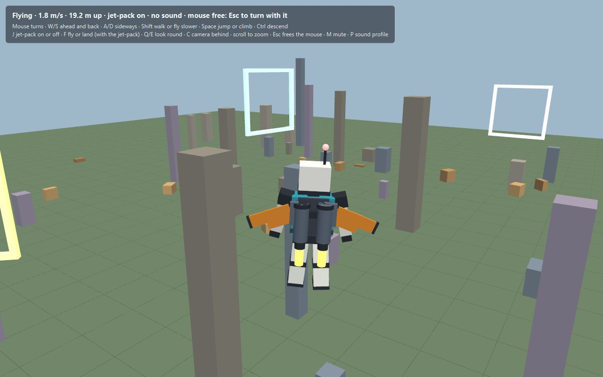

# avatar-demo — a box-rig avatar in plain JavaFX 3D

A standalone experiment: a small robot built from boxes that walks, runs and jumps around a
world of pillars, crates and floating gates, followed by a chase camera. Put on its jet-pack
and it flies as a drone does: upright, tipped gently toward where it goes, holding its place
when let go. Everything is heard as well as seen. Two sound profiles give the same world two
characters, and three separate benches are for working on the sounds: one for all of them, one
for the engines, and one for the Gatling guns.



- **No mesh or skin.** Each limb is a rigid part hung from a joint. The animation is worked
  out each frame from how the body moves, the way blocky game characters are animated.
- **A solid world.** The avatar slides along what it runs into, stands on top of blocks,
  jumps up onto the lower crates (try the staircase straight ahead of the start), falls off
  edges, and lands on pillars it flies down onto. The layout (`Course`) is plain data that is
  both drawn and collided with, so what you see is what stops you.
- **Ramps.** A block's top can slope (`Block.ramp`): what stands on it stands on the slope where
  it is, rounds meet the slope, and its high sides are walls. The robot runs up a ramp on its
  feet and down one without a hop: on its feet, it keeps its footing on a surface falling away
  under it, a slope or a ledge no higher than a step. The flyover demo has a road across the way
  ahead of the start, up a ramp of one in four, over a deck 4 m up, and down the other side,
  with room to run under the deck; and further on, a ramp on its own to leap off.
  The playground has two flyovers of its own: one behind the start, carrying a road across over
  a street that runs out from the start under it, and another off to the right, carrying a road
  over a street running out east. The crates and pillars that were scattered where the roads run
  are cleared away; everything else is where it was.
  And everything since is in it too: down the street behind the start, the four vehicles parked
  two each side of it, the roadster and the van on its west side, the pickup and the truck on
  its east; out west, the bunker with its heavy Gatling gun and the gunship standing ready by it;
  and off to the east, behind the start, an airship moored low to be boarded and flown, bombs and all, beside
  the three that sail their routes overhead.
- **Land vehicles: a bare chassis.** What a car or a truck is built on (`Course.Chassis`): a flat
  bed on wheels, a steering wheel on a column, and nothing else yet. The car's is 4 m long on four
  wheels; the truck's 7 m on six, its back four on two axles together. Stand beside the driver's door (or at the
  steering wheel, on a bare chassis): T gets in. W speeds it up, S brakes and then reverses, A and D steer,
  Space is the handbrake, Shift goes gently; the mouse does not turn it. Only the front wheels
  steer, so it turns about its back wheels, as racing games have it, the less sharply the faster
  it goes. Each wheel finds the ground under it: it drives up and down ramps and over the
  flyover, tipped as the slope is, leaps off a ramp's head, and stops dead against anything
  standing higher than a kerb. The driver sits in a seat behind the steering wheel, kart-fashion,
  its legs out ahead and its hands on the wheel, and is carried with it.
  Low on the right, as racing games have them, its instruments: a round tachometer, its needle
  sweeping up toward the red line (6,500 for a V6, 6,000 for a V8) and dropping back at each change
  of gear; the gear, big, in the middle of the dial, R going back; and the speed in km/h under it.
  Each is a vehicle of the engine bench's (`Vehicle.of`), and goes as it does: its real top
  speed, as its engine, its gears and the air make it there (the car about 249 km/h, the pickup
  limited to 185, the truck to 120, the scooter 97, the sport bike 236, the cruiser 182), and
  getting up to speed as it does, briskly from a standstill, less and less so as it nears its top,
  as quick as on the bench to make most of it (`Course.Drive.accelAt`). Its gearbox (`Gearbox`) is
  the bench vehicle's too, the same gears, final drive and wheels (`Vehicle.rpm`): at any speed,
  in any gear, the same revs as on the bench. Six gears in the car and the pickup, eight in the
  truck. It changes by itself, as a quick automatic does: up near the red line pulling hard, up
  early cruising (a car at 90 km/h in sixth, under 2,000 rpm), down as it slows, down a gear or
  two flooring it; the throttle cut for a moment at each change, blipped going down; the clutch
  slipping pulling away. On a cross-slope, a banked turn, a land vehicle rolls as the ground
  under its left wheels and its right does, its driver rolled with it (`Lift.roll`).
- **The track.** A NASCAR-style oval, a demo of its own (`Course.trackDemo`), in a world now
  900 m across: two straights of 400 m and two turns of 120 m radius, 24 m wide, about 1.55 km
  round, like a one-mile oval. Flat all round for now: banked turns (`Course.TRACK_BANK`, the
  banking easing in and out over the first and last fifth of each turn) wait on vehicles settling
  well on uneven ground. A concrete wall all round its outside, a paler apron round its inside, a
  white line across the front straight to start and finish at, pit road inside the front
  straight, and grandstands outside it. Every land vehicle stands on pit road, heading the way
  they race, round to the left: the roadster, the van, the pickup, the truck, the scooter, the
  sport bike and the cruiser. Driven flat out, the roadster laps it from a standing start, at
  240 km/h down the straights.
  The car carries a heavy Gatling gun fixed to the right of the seat: it does not turn on its
  own, but fires the way the car faces, tipped up or down with it on a ramp, and whoever drives
  fires it with a click (a weapon in the hands stays quiet meanwhile). This is the other way a gun
  is held: moving with what holds it, as the hands hold theirs, rather than aimed freely on a
  mount (`Course.Mount#fixed`).
  The pickup (5.2 m, four wheels) has its seat well forward, and on a post at its back, high
  enough to fire over the driver's head, a heavy Gatling gun aimed freely: what a pickup with a
  gun, or an armoured vehicle, is built on. T at its door takes its wheel, and its gun with it
  (gun control): the keys drive it, A and D steering as ever, and the mouse aims the gun all
  round, 10° down and 45° up, a click firing it; the gun holds its aim on the world as the
  pickup turns under it. The view stays the pickup's, behind it, the gun's sight marked where it
  points. G gives the gun up, and the pickup is driven as any car is; G again takes it back.
  Crates stand about behind the start, to turn it on.
- **Bodies.** On the Roads demo each chassis wears a body: the car a low open roadster, blue; the
  truck a square cab over its front wheels and a flatbed, orange; the pickup a cab with a sloping
  windscreen and an open bed round its gun, red; and a van on the car's chassis, cream, tall and
  boxy, its windscreen glazed before the driver and open on the right as a port for the car's
  fixed gun, its sides glazed behind the driver's door, and a hatch at the back. Every body has
  bumpers, headlamps and tail lamps, and the view rides over its roof. A body is sheets of metal and glass, drawn by a
  renderer of their own (`Sheets`): each sheet a flat panel of any outline, hollows and all, as
  thick as it is, seen from either side; built from a side profile pushed out across the body,
  outlines at its sides, and single panels (`Bodies`). Rough for now, flat and few, but finer
  shapes are only more sheets. To the world a body is nothing but how the vehicle takes harm
  (`Course.Bodywork`): its armour makes it tougher, and its plating takes something off every
  blow; and its solid boxes, a rough match for its panels (the van one tall box, the pickup a
  cab and its bed's sides), are what rounds strike and what bumps into it, the chassis's own
  parts and the body's together. With the body round the seat, a vehicle is got into from the
  ground beside the driver's door (T), and let out there; at the wheel, the driver sits still in
  it, carried.
- **Collisions.** A land vehicle running into something that gives, a crate or another
  vehicle, collides with it as their masses and speeds say (`Play.collide`): every vehicle has
  its mass, its bench vehicle's (`Course.Drive.mass`: the car 1,450 kg, the pickup 2,100, the
  truck 6,500, the bikes 195 to 395 with their riders), and every loose thing its own
  (`Loose.mass`). The push between them is along the line from one's middle to the other's,
  momentum kept, and they part a little (bounce 0.2). A truck shoves a crate on, hardly slowed;
  a car running into the parked truck stops short and barely moves it; the truck running into
  the parked car sends it off at about the truck's own speed. A vehicle shoved rolls on ahead,
  and shoved sideways its tyres scrub that off hard. Kept on the throttle against a crate, a
  vehicle pushes it along ahead of it. The energy a collision takes out of the two, past a
  gentle push's 1.5 kJ, harms them both, a crash blow (`Weapon.CRASH`) each for every
  kilojoule: the pickup at 50 km/h breaks a crate, and is dented. What does not give, a wall, a
  pillar, a ramp's side, stops it dead, as ever.
- **Two-wheelers: a scooter and motorcycles.** The same chassis, on two wheels in line under a
  narrow frame, with handlebars over the front wheel on raked forks (`Course.Chassis`,
  `twoWheels`): a scooter, small-wheeled, teal, its engine under a cowl beneath the seat, a
  floorboard for the feet and a shield before the legs; a sport bike, red, its nose fairing, a
  tank to tuck down over, a raised tail and a pipe out the back, the quickest of everything that
  drives; and a cruiser, long and low, dark blue, a teardrop tank, its V-twin's two cylinders
  standing out of the engine, fenders over both wheels and long chrome pipes down the right.
  Got onto from beside them (T), ridden as a car is driven, and got off again there. The rider
  sits astride, as the bike has it: upright on the scooter, feet forward on the floorboard;
  tucked over the tank on the sport bike; sat back on the cruiser, feet out ahead, arms out to
  wide bars. Each leans into its turns as a rider would lean it to balance going round
  (`Lift.lean`): the harder the faster it goes round, at most 45°, upright going straight, the
  rider leaning with it about where its tyres touch the ground; only how it is shown, to the
  world it stands as ever. Each has its engine from the engine bench: the scooter a 125 cc
  single on a CVT, which holds it most of the way up its revs as the speed builds (D on the
  dial); the sport bike a 90° L-twin with six gears, changed in a flash; the cruiser a 45°
  V-twin, its uneven beat, with five. They stand behind the start on the Roads demo, and along
  the street on the playground.
- **A bunker with a heavy Gatling gun.** A concrete pillbox, its gun on a pedestal behind a slit
  along its front. Walk up to the door at its back and press T to man it: the robot is inside, out
  of sight, and the view is the gunner's, from just behind the gun, looking out through the slit.
  The gun is aimed freely, not by turning the robot (`Turret`): the mouse swings it round, 55°
  either way, and up and down, 8° down to 25° up, no faster than 70° a second, as a heavy
  thing turns. Click fires, as every gun fires (`Gun`): held, its six long barrels spin up over
  1.2 s, then it fires 30 rounds a second, each five times the hand-held Gatling gun's, for as
  long as it is held (a mount can be made to overheat, but neither gun does for now). Its rounds
  go out through its own bunker. Wreck the bunker (it takes 2500) and the gunner is thrown out. T
  again steps out of the door.
- **A gunship.** A platform with a heavy Gatling gun on its console. Jump onto its deck and stand
  at its console: T takes it, and its gun with it, as on the pickup. W and S fly it ahead and
  back, A and D turn it, Space and Ctrl climb and descend; the mouse aims the gun, all round, 30°
  down and 40° up, and the gun holds its aim on the world as the gunship turns under it
  (stabilized). The view is the gunship's, behind it. G gives the gun up, and it flies as any
  platform does (A and D sideways, the mouse turning it); G again takes it back. T again lets
  go, and the gunship eases to a stop and hangs there.
- **A jet with swing wings.** Avatar and pack are drawn as a fighter jet standing on its
  tail, held up by the thrust of its twin engines. The wings lie in the plane of the back and
  pivot there as a variable-sweep fighter's do. They are tucked along the engines on the
  ground, spread wide to hover, and swept further back the faster it flies. They are as solid
  as the body: a wing that meets a post stops the flight, and one that clips an edge glances
  off.
- **Weapons.** Two AK-style rifles, one in each hand, held from the hip as a soldier fires
  from it: each stock clamped between the upper arm and the body, the forearm folded along the
  rifle to the pistol grip. They fire in turn, left and right, each forearm kicking up as it
  fires, with a flash at the muzzle and a brass casing thrown out. Or a glaive as Guan Yu
  carried, a long pole with a broad crescent blade, standing upright in the right hand. Its
  strokes go in turn: a cleave over the head, then a sweep across. Or a Gatling gun with a
  motor, held at the right hip by its grip, the left hand reaching across to a lever on top.
  The left arm is worked out each frame to keep its hand on the lever wherever the gun points.
  Its six barrels spin up before it fires, 2,400 rounds a minute, and spin down when let go.
  The robot holds it dead steady, every round along one line, with a tracer every third round
  and casings pouring out.
- **Aiming and hits.** The rifles shoot straight ahead of the body, wherever the head or the
  camera is looking round: to aim, turn the body. Up and down follow the view instead: tilt it
  up from where it rests and the guns aim up as far, tilt it down and they aim down, up to
  50° either way for the rifles and 30° for the heavier Gatling gun. At rest, and walking, they
  shoot level. A crosshair out in the world marks the
  line the rounds fly along, where it meets a block or the ground, or 30 m off. It is only a
  mark: it never steers a round. Being in front of the avatar, it never hides it. Each round
  flies from its own muzzle, spread a little as rounds from the hip are, with a tracer. Where
  it strikes a block it throws sparks and leaves a bullet hole; on the ground, a puff of dust.
  The glaive strikes whatever is within its reach as the blade comes through. A cleave chops
  into the ground in front, and a sweep catches what is beside; on a block the blade leaves a
  gash. The marks fade after a while.
- **Targets and damage.** A range of wooden target dummies stands off to the left of the start,
  more behind it. (Drones are left off the maps for now: their model got in the way of the land
  vehicles. The kind, its looks and its sound are all still there, to bring back.) High over everything, far out, three great
  armoured airships go slowly round the start, a lap taking the best part of two minutes. Each
  is 18 m long, with a stepped steel hull banded in yellow, a cross of tail fins, a lit gondola
  underneath and an engine with a turning propeller either side. Each part of one is solid, so
  it can be landed on, and whatever stands on one is carried along with it, turned as it turns,
  and can walk about on it as it goes. They, and the crates, can be broken; pillars and
  gates stand whatever is thrown at them. Every round or stroke takes some of what a piece can
  take:
  - a rifle round takes 10, a Gatling round 8 (but 40 a second), and a stroke of the glaive 100;
  - a dummy can take 300, a drone 120, and an airship 3,000: most of ten seconds of the
    Gatling gun. A crate takes from about 90 to 600, by its size.

  As it wears down it darkens and cracks, and a bar over it shows what it has left. An airship
  catches fire instead, in more places as it nears its end. The blow that takes the last of it
  breaks it: a crate or dummy bursts into pieces that tumble, bounce and come to rest, and a
  drone goes up in a fireball. An airship goes up in blast after blast along its hull and rains
  wreckage from the sky. Broken is for good, until the demo starts again. It is gone from the world, so rounds fly on through where it stood and whatever stood
  on it falls. The HUD counts the targets down and the crates broken.
- **Bombs.** Each airship lets a bomb go every three seconds, in turn, wherever it is: carpet
  bombing. A bomb falls from under the gondola, carrying on the way the airship was going, and
  goes off at the first thing it meets, in a fireball, embers and, on the ground, clods of earth
  thrown up. Every crate or target within 3.5 m of it takes 150: a drone or a small crate goes at
  once, a dummy takes two. The robot takes no harm from them yet.
- **Platforms, flown like magic carpets.** Two steel platforms float just off the ground, edged
  in yellow and black, a thruster glowing under each corner and a console at the front: a
  small one, 3 m by 2.4 m, off to the right of the start, and a broad barge, 10 m by 6 m, off to
  the left. A platform is as big as it is made for what it is for (`Course.Deck`). Jump onto
  one and stand behind its console, and the HUD offers the controls (T). At them, the keys that
  would move the robot fly the platform: W and S ahead and back, A and D sideways, the mouse
  turns it, Space climbs and Ctrl descends, from just off the ground to 45 m up, Shift to go
  carefully. It eases up to speed and to a stop, and stops short of anything in its way, with
  room over the deck for whoever rides it. The robot stands at the console and is carried and
  turned with it, and can still draw a weapon and fire. T again lets go, and it hangs where it
  is. F at the controls cuts its engine: its thrusters go dark, it cannot be flown, and it drops
  until it settles on whatever is under it (the ground, a crate or pillar, an airship, another
  platform, or the robot's head) and rests there. Resting on something that moves, it is
  docked: set one down on an airship and it goes round with it, the pilot aboard; set the small
  one down on the barge and it goes wherever the barge is flown. F again starts it, and it lifts
  off from there. Whatever moves (the airships, the platforms) is drawn where the simulation says it was at
  its last two steps, part way between, and marks on it go with it.
- **Vehicles.** The platforms and an airship to be flown are vehicles (`Course.Craft`): each
  handles as it does (`Course.Handling`), takes damage and breaks like anything else, and, at
  its controls, the camera is the vehicle's: it follows the vehicle from as far back as it is
  big. A platform is open: the robot rides it in plain sight. An airship is closed: walk in
  under its gondola, take it (T) at the hatch in its floor, and the robot is inside and out of
  sight, at its controls and those of the giant Gatling gun in a ball turret hung under the gondola's back end (half
  as big again as the heavy one, its rounds two and a half times as heavy, 1,200 a minute). W and
  S fly it ahead and back, A and D turn it (slowly, as an airship turns), Space climbs and Ctrl
  descends, never below its moorings; it has no sideways and its engines are never cut. The
  mouse aims the gun, all round, 80° down and 10° up, and the gun holds its aim on the world as
  the airship turns; a click fires it, spinning up first. The view stays the airship's, behind
  it. A and D steer it always, as a car's wheel would: it cannot go sideways. G gives the gun
  up, the mouse then left alone and a click dropping a bomb; G again takes it back. A right-click drops a bomb
  from under the gondola, going as the airship goes; held, a stick of them, one every 0.4 s. Its bay holds a dozen, and loads them back, one a second,
  when it is down at its moorings (no bombs are dropped there). Low over its own bombs, it takes
  their blast too. T again and the robot drops out of the hatch, from wherever it is. Broken
  while flown, a vehicle throws out whoever flies it. At a vehicle's controls the HUD is the
  vehicle's: how fast and high it goes, how much of it is left, its engine or its bombs, and
  its own keys in place of the robot's. Low on the left, a small control panel shows what can be
  done there, each with its key (the gun, a bomb, first person, the camera, getting out): free
  the mouse with Esc to click them.
- **The fruit stall.** On the barge stands a fruit stall: a table of planks on pallets under a
  red and white awning, a sign (西瓜), a scale, a row of striped watermelons and a few more on the
  deck, and three pineapples standing at the other end. The stallholder sits on a stool behind it; a customer stands before
  it, and another sits on a scooter parked to one side. All of it goes with the barge wherever
  it is flown, and standing on it rides too. Every piece of fruit is one kind of thing (`Fruit` says which, how big and how tough), to
  be shot or cut: a watermelon takes three rifle rounds, four of the Gatling gun or one stroke of
  the glaive, a pineapple two rounds. Struck, it splashes juice, red or gold, and the
  stallholder shakes a fist; burst, it throws its flesh and skin, seeds or leaves, with a wet
  splat, deeper for a watermelon, and everyone jumps, hands in the air. The HUD counts the fruit
  smashed.
- **Loose things: furniture, fruit and crates.** The crates are loose too (`Crate`): each as
  heavy as its planks, a hollow box at 18 kg a square metre of its sides, so a two-metre crate
  is about 450 kg. Too heavy to shove by hand, they stand where they are until a vehicle runs
  into one. The table and the fruit are loose things (`Prop`): each
  stands on whatever is under it (the deck, the table, the ground), and goes where that goes, so
  the fruit rides the table and the table rides the barge. Walk into one and push, and it slides
  the way you push it, as readily as it gives (`Loose#give`): fruit at your pace, the heavy table
  at under half of it; it slides to a stop, and stops short of anything in its way. Push one
  into another and you push both: a row of melons goes along together, front to back, heavier
  going the more there is (each one's give adds up as weights do), and a melon pushed against the
  table pushes the table; against a pillar, nothing moves. What stands on it goes with it: push
  the table and its fruit goes too. Pushed off an edge, or with what
  held it up broken, it falls; landing harder than it can take (`Loose#landing`), it breaks, so a
  watermelon dropped from three metres bursts while one off the table is fine. Furniture
  (`Furniture`) is broken like anything else: the table takes twenty rifle rounds or two strokes
  of the glaive, and what was on it drops to the deck. The stallholder's stool and the scooter
  are furniture too, and whoever sits sits on top of theirs: push the stool or the scooter and
  they ride along on it; push them, or break it, and they come off it to stand on the deck.
- **People.** The people at the stall are characters in the world (`Person`), each with a body
  like the robot's: they stand on whatever is under them, ride the barge wherever it is flown,
  and fall. Walk into someone and they are shoved out of the way, sent along at your pace and a
  little more; shove them off the edge of the deck and they fall off. A push gets anyone sitting
  to their feet, and people pushed into each other part. Rounds, the glaive and bombs strike
  them: each hit knocks them back a little and they stagger. A fall hurts them too, the harder
  they come down the more: stepping off the barge at the ground does nothing, a fall of four
  metres costs a third of them, seven or more is the end. Six rifle rounds, a stroke of the
  glaive, a bomb nearby or a long fall, and they are destroyed: they blow apart in a puff of
  fire, in their own colours, and are gone. The HUD counts the people down.

## Build and run

From the repository root:

```bash
mvn -pl avatar-demo -am package
java -jar avatar-demo/target/avatar-demo.jar
```

It opens on a choice of demos: the **playground**, everything at once (the course, its targets and
airships, the flyovers, the four vehicles, the bunker, the gunship and an airship to fly), or one built round a
single vehicle, open and simple, so the vehicle is all there is to look at: the **flying
platform**, among a few pillars and gates, and the **airship**, moored by the start, with a yard of crates beyond it to
bomb; the **roads**, a flyover and a ramp, with a car's chassis and a truck's to drive on them; the **guns**: a bunker
and a gunship, each with a heavy Gatling gun, and crates and dummies out in front; and the **track**, a NASCAR-style
oval to take every land vehicle round flat out (`Demo`).
Click one or press its number. In a demo, the menu bar along the top has them too (Demo):
switch straight to another, or start this one again; with the view (first person, the camera
behind) and the sound (mute, profile) alongside. Tab comes back to the choice. Right clicks are
left to the game.
`-Davatar.demo=AIRSHIP` (or `PLATFORM`, `FLYOVER`, `GUNS`, `TRACK`, `PLAYGROUND`) goes straight to one.

One self-contained jar carries JavaFX and the OpenAL libraries. The same jar opens the sound
bench with `--bench`, the engine bench with `--engine`, the gun bench with `--guns`, or writes every sound to WAV files with `--sounds [folder]` (see
[Sound](#sound)).

## Controls

The mouse turns the avatar with no button held, as in games. The cursor is hidden and kept in
the window, so clicks stay free for actions.

| Key | On foot | In flight |
|---|---|---|
| Mouse | Turn | Turn |
| W / S | Ahead, back | Ahead, back |
| A / D | Sideways, without turning | Sideways |
| (no Shift) | Run | Full boost |
| Shift (held) | Walk | Cruise |
| Space | Jump | Climb |
| Ctrl | | Descend |
| J | Put the jet-pack on, or take it off | Take it off (and fall) |
| T | Take a platform's controls, behind its console, a chassis's, at its steering wheel, board an airship, under the hatch in its gondola's floor, or man a bunker's gun, at its door; or let go of them (step out). At them, W/S/A/D, the mouse, Space and Ctrl fly it, and F starts or cuts a platform's engine | |
| F | Take off (wearing the pack) | Stop flying |
| Q / E (held) | Swing the camera round | Swing the camera round |
| C | Camera behind | Camera behind |
| Scroll | Zoom | Zoom |
| M | Mute or unmute | Mute or unmute |
| P | Next sound profile | Next sound profile |
| 1 | Draw the twin rifles, or put them away | Draw the twin rifles, or put them away |
| 2 | Draw the glaive, or put it away | Draw the glaive, or put it away |
| 3 | Draw the Gatling gun, or put it away | Draw the Gatling gun, or put it away |
| Left click (held) | Fire, or swing; at a vehicle's controls, fire its gun (aboard the airship with its gun given up, drop a bomb) | Fire, or swing |
| Right click (held) | Aboard the airship, drop a bomb (held, a stick of them) | |
| G | At the controls of the pickup, the gunship or the airship: give up control of its gun, or take it back | |
| Esc | Free the mouse, or take it back | Free the mouse, or take it back |
| V | At a vehicle's controls: first person, or back | The same |
| Tab | Back to the choice of demos | Back to the choice of demos |

As in most shooters, it goes at full speed unless Shift is held. `-Davatar.pack=true` starts
with the jet-pack on. Clicks fire only while the mouse is captured, so a click to take the
mouse back never fires. Aim left and right by turning the body with the mouse, and up and down
by tilting the view with it; looking round (Q/E) does not move the aim.

## Sound

Every footfall is heard, on the ground or on a block, along with each jump, landing (as hard
as the fall), bump and gate flown through, the pack, and its wings swinging. So is every round from each
rifle's muzzle, every stroke of the glaive, and each weapon as it is drawn. The Gatling gun in
hand or manned is made as it turns and fires, shot by shot as the gun fires them, its motor
whining up and down with its spin, mixed realistically or as a film would (the Sound menu; see
[Gun bench](#gun-bench)); the Arcade profile loops its chip's whine and roar. What they strike
is heard where it is struck: a round on a block, ticking or ricocheting, or thudding into the
ground; the blade clanging off a block, or chopping into the earth. What breaks is heard where
it stood: a crate or dummy splintering and its pieces clattering down, deeper the bigger it
was, a drone blowing up, or an airship coming down in a chain of blasts with its frame
groaning. Explosions are loud all through, as a blast overloads a microphone, and carry: a
footstep is heard in full only within 3 m, a drone blowing up within 15 m, a bomb within 30 m, an airship coming
down within 60 m. For a moment each one pushes the rest down (the jets, the wind, the Gatling
gun's roar), as games mix them, so it punches through. The nearest airship still in the sky
drones from where it is, faint from the ground and loud alongside it. The vehicle being driven
  is heard from under its bonnet: a V6 in the roadster and the van, smooth and raspy, every third
  of a turn a cylinder firing; a V8 in the pickup and the truck, deeper, its cross-plane firing
  order giving it its lumpy burble; a buzzing single in the scooter, an L-twin's hard beat in the
  sport bike, and a V-twin's uneven one in the cruiser. In the Robot profile the engine is made as it runs, the
  engine bench's own (`EngineVoice`, played as a stream by `EngineStream`): each cylinder firing
  in turn at the revs the vehicle is at, down its runner into its pipe, so it climbs through its
  gears as the vehicle gathers speed and drops back at each change, its note the revs' while its
  pipes ring where they are; louder and harsher with the throttle open and worked hard; and
  lifting off at speed, held back, popping. The Arcade profile loops its chip's engines, pitched
  up with the revs, as ever. The jets roar as
hard as they fire, and the wind rises with speed. The listener stands at the avatar but faces
the way the camera does. So the avatar always sounds near, however far the camera pulls
back, and left and right match the screen.

- **Profiles.** Every sound is made from noise, filters and tones, not recordings, in one of
  two profiles:
  - **Robot:** metal and motors, as real as can be made.
  - **Arcade:** an old console's sound chip, with square-wave blips, noise bursts, arpeggios
    and stepping pitch.

  P switches between them while playing; `-Davatar.sounds=arcade` starts with Arcade.
- **Outputs.** OpenAL (through LWJGL) is tried first. If it is missing from the build, its
  native library won't load, or there is no device, the demo falls back to Java Sound, which
  ships with Java, and then to silence. Each fallback says why. `-Davatar.audio=javasound`,
  `silent` or `record` picks the output.

### Sound bench

The sounds are worked on apart from the game, on a bench of their own:

```bash
java -jar avatar-demo/target/avatar-demo.jar --bench
```

- Choose a profile, and every sound and loop changes character with it.
- Play a sound (Space or Enter) softer or harder, take after take, from any direction and
  distance round the listener, at any pitch.
- Run the jet and wind loops, and drive them with thrust and speed sliders by the same rules
  the game uses.
- See each waveform with its length and loudness. Save one sound, or all of them, as WAV
  files.
- Switch the output while it runs. With no device, everything can still be seen and saved.

With no window or sound card at all, `--sounds [folder]` writes every sound of every profile to
WAV files, a folder for each. It also writes two scenes mixed in stereo (footsteps walking
past, the jets flying by) and says which outputs this machine can open.

### Engine bench

The engines are worked on on a bench of their own:

```bash
java -jar avatar-demo/target/avatar-demo.jar --engine
```

An engine here is not a recording sped up: its sound is made as it runs, from its revs and
throttle (`EngineVoice`). The crank turns, and each cylinder fires as the crank comes round to
its place in the cycle, by the engine's own firing pattern, into its bank's pipe. The pipes ring
at a few notes of their own, which stay put whatever the revs. So the firing note climbs with
the revs while the pipes' ring stays where it is, and it sounds like the same engine working
harder. On top come the intake, roaring with the throttle open; a harsher, louder note when it
is worked hard; and pops and crackle off the throttle at speed.

- Pick an engine (`Engine`). For cars: an inline four; an inline five, its odd number of
  cylinders (every 144°) giving it a warble; a V6; a cross-plane V8 with its lopsided burble;
  or a flat-plane V8 that screams. For scooters and motorcycles: a 50 cc two-stroke scooter, firing every turn into an expansion chamber, high and raspy; a 125 cc
  four-stroke scooter, a busy little buzz; a big single, each thump heard on its own at idle;
  a 45° V-twin, firing 315° then 405° apart, the cruiser's uneven beat; a 90° L-twin, 270°
  then 450°, harder and higher-revving; and a 360° parallel twin, evenly, a single's beat at
  twice the rate. Each is a set of figures (two strokes or four, its firing pattern, idle and
  red line, how briskly it revs, its pipes), so another engine is another set of figures.
- Pipe it (`Exhaust`). Each engine fires in its real firing order (1-8-4-3-6-5-7-2 for the
  cross-plane V8, 1-5-3-7-4-8-2-6 for the flat-plane, 1-2-4-5-3 for the five, ...), each
  cylinder on the bank that order puts it on, and each cylinder's pulse goes down a runner of
  its own: as late as the runner is long, ringing at its note, into its bank's collector. Runners
  of unlike lengths bring evenly fired pulses to the collector unevenly, so the order is heard:
  the five's stock manifold makes its warble. Choose the stock manifold or equal-length headers;
  and, on an engine with two banks, true dual pipes, an H-pipe, or an X-pipe, which evens out a
  cross-plane V8's burble.
- Charge a car's engine, or not (`Charger`): any of the five may be turbocharged or
  supercharged, by the Induction choice.
  - A turbocharger (`Turbo`, heard by `TurboVoice`) is spun by the exhaust, so its boost comes
    late, after a lag, and only under load; it whistles higher as it spins up, softens the
    exhaust, and its blow-off valve hisses whenever the throttle snaps shut on boost, lifting
    off or changing gear.
  - A supercharger (`Supercharger`, heard by `SuperchargerVoice`) is driven off the crank, so
    its boost comes at once, some even low down; it whines at a note geared to the revs, and
    off the throttle lets the boost go without a hiss.

  Either way the readout shows the boost, and driven, the engine pulls harder the more there
  is. The rally coupe's five comes turbocharged.
- Rev it free: hold Space (or W) for full throttle, or set the throttle by its slider. It revs
  up as briskly as that engine does, falls back to its idle, and held flat out it bounces off
  the limiter (`Revs`). Or hold the revs anywhere in its range, to listen to one place.
- Set the load, from revving free to pulling hard.
- Or drive it: each engine is in a vehicle of its own (`Vehicle`): a hatchback, a saloon, a
  rally coupe, a muscle car, a supercar, two scooters, a dual-sport bike, a cruiser, a sport bike and a classic
  bike, each with its weight, torque, gears, wheels, drag and grip, and, some, a speed it is
  limited to; and the game's own: its car (the roadster's and the van's), its pickup and its
  truck, and its scooter, sport bike and cruiser, which go here exactly as in the game, the same
  revs at the same speed (the Vehicle choice, of those with the engine picked;
  `-Dengine.vehicle=pickup`). W or Space is the throttle,
  S the brake, E or Up changes up and Q or Down changes down, or the gearbox changes by itself:
  up near the red line flat out, up early cruising, down as it slows (`Driving`). It pulls away
  on a slipping clutch; in gear the revs follow the road speed, dropping at each change up and
  blipped at each change down; off the throttle it holds back, and pops; braked to a stop, the
  clutch goes out and it idles. The scooters' CVTs hold the revs steady as the speed builds.
  The tachometer shows the gear and the speed.
- Watch the tachometer, the sound as it is made, and its frequencies: the firing note marked
  in orange, moving with the revs, and the pipes' notes in blue, staying put.

It plays through Java Sound. `-Dengine.pick=V8` (or `I4`, `I5`, `V6`, `FLAT_V8`, `SCOOTER_2T`,
`SCOOTER`, `THUMPER`, `V_TWIN`, `L_TWIN`, `PARALLEL_TWIN`) picks the engine to start with, and
`-Dengine.charger=turbo` (or `super`, `none`) charges a car's. The game's V6 and V8 are these,
stock, made the same way as they are driven ([Sound](#sound)).

### Gun bench

The Gatling guns are worked on on a bench of their own:

```bash
java -jar avatar-demo/target/avatar-demo.jar --guns
```

A gun here is not a roar looped: its sound is made as it turns and fires (`GatlingVoice`). Its
barrels go round as fast as they are spun, and each time one comes to the top it is fired, if
the gun is up to speed: so the shots come exactly as often as the gun fires them, forty a second
for the hand-held gun, thirty for the heavy, twenty for the giant, and run together into its
note. Each shot is a blast of air out of the muzzle, a short push and pull as long as the round
is big; a thump after it, lower the bigger the round; the round's crack; and the clack of its
bolt, each a little unlike the last. Under them the motor whines, its gears meshing at their
note, rising as it spins the barrels up and falling as they run down, labouring as it fires; the
barrels whoosh round; the giant's hydraulic drive hisses. Turning without firing, each bolt
clicks over dry. The empty cases ring as they land, as long after as they take to fall. The
ground sends the blast back, as late as it is far below: about 0.6 s from the airship a hundred
metres up.

- Pick a gun (`Gatling`): the hand-held one, the heavy one on a mount, or the giant one under the
  airship. Each is a set of figures (its gun's rate and spin-up, its barrels, its rounds'
  calibre, its motor and gearing), so another gun is another set of figures.
- Pick a mix (`GunStyle`): **Realistic**, as a microphone outdoors would have it, a sharp, dry
  crack with the mechanism plain under it and the cases ringing; or **Cinematic**, as a film
  would mix it, a thump and a boom an octave under it in each shot, driven hard into overload,
  rolling away in a long tail.
- Hold Space (or the Fire button) to fire: it spins up first, as long as that gun takes, and
  fires at full speed; let go, it stops at once and runs down. Hold S to spin it without firing.
- Set its height over the ground, for the ground's echo and the cases.
- Watch the sound as it is made, each shot to be seen, and its frequencies: the shots' note in
  orange, each shot's thump in red, and the gears' whine in blue, moving with the spin.

It plays through Java Sound. `-Dgun.pick=GIANT` (or `HAND`, `HEAVY`) picks the gun to start
with, `-Dgun.style=realistic` the mix, `-Dgun.height=80` its height. In the game, the Robot
profile makes the Gatling gun in hand or manned the same way, mixed as the Sound menu says
(`-Davatar.guns=realistic` to start so; cinematic otherwise). The Arcade profile loops its
chip's gun as ever.

## Unattended runs

A script drives the demo without a keyboard, for pictures, checks and recordings. It leaves the
real mouse alone, and plays no sound unless `-Davatar.audio` names an output.

```bash
java -Davatar.script="J;F;SPACE:1.2;W+@90:2" -Davatar.snapshot=out.png -jar avatar-demo/target/avatar-demo.jar
```

- **Parts** are separated by `;`. Each holds its keys (joined by `+`) for its seconds, so
  `W+SHIFT:1.5` walks ahead for a second and a half. A part without seconds is a tap, and
  `:1` just waits. An `@90` among a part's keys turns 90° over the part, as the mouse would,
  and `^20` tilts the view up 20° (down, when negative).
  `FIRE` holds the trigger, as the left mouse button would, so `DIGIT1;FIRE:1` fires the
  rifles for a second.
- **It plays in the world's own time.** The script becomes inputs stamped with the step they
  come in at (`Script`), 120 to the second, starting half a second in; while it plays, it alone
  drives the world. So the same script gives the same run every time, however the frames fall,
  and the tests play scripts with no window at all. The keys mean the same to a script as at
  the keyboard (`Keys`).
- **`-Davatar.inputs=run.inputs`** keeps the run's inputs as it goes, whether from the keyboard
  and mouse or a script (`Recording`), and **`-Davatar.replay=run.inputs`** plays them back from
  where the run started: the same run, to the bit, seen and heard as it was. Only the inputs are
  kept, a line when they change, so a key held for a minute is one line; what follows from them
  (where the avatar went, what broke) is stepped again. A checksum of the world every second
  tells the replay it is still the same run, or where it first went astray (the rules changed,
  say, or the file was edited). The camera's own keys are not kept: they change nothing in the
  world.
- **Frame times** are printed once a second (`frames: 60 fps | frame 16.7 ms, worst 32.1 | update
  0.4 ms, worst 0.7`), as the HUD shows them: how many frames, the average and worst gap between
  them, and how long the demo's own work took in each, apart from JavaFX's drawing. The worst is
  what is felt as a stutter. On the HUD the line turns amber below 55 fps, or when a frame takes
  twice as long as it should.
- **The demo** a script plays in is the playground, or `-Davatar.demo` names another. A
  recording keeps the demo it was made in, and its replay plays there.
- **`-Davatar.snapshot=out.png`** saves the window just before the script ends, and exits.
  `-Davatar.settle=<ms>` picks the moment instead, counted in the world's time.
- **`-Davatar.audio=record -Davatar.record=flight.wav`** writes a stereo WAV of exactly what
  would have played, kept in time with the game. It is for hearing a run afterwards, or
  checking it without speakers:

```bash
java -Davatar.audio=record -Davatar.record=flight.wav -Davatar.script="W+SHIFT:1.6;J:0.6;F:0.3;SPACE:1.2;W:2.5;CONTROL:3.5;:1" -Davatar.snapshot=flight.png -jar avatar-demo/target/avatar-demo.jar
```

## How the code is layered

One simulation is the single truth. Each output reads it, the graphics and the sound alike,
and none writes to it. So the sound could be added without touching the graphics, and every
rule of the world can be tested without a window or a sound card.

The simulation keeps its own time (`Clock`), apart from the frame rate. It always moves in
steps of exactly 1/120 s: two for each frame at 60 a second, more or fewer as the frames run
short or long, with what is left over carried on to the next frame. So the world comes out the
same, to the last bit, at 30, 60 or 144 frames a second, or an uneven mix of them. What is seen
and heard is the world between its last two steps, blended by how far on the next one is, so it
glides rather than ticking. A frame that runs very long takes no more than a tenth of a second
of steps, and lets the rest go rather than falling ever further behind.

| Package | What it is |
|---|---|
| `sim` | The one truth, stepped on its own clock (`Clock`; `Play` steps the avatar, the damage and what moves together: the airships on their routes and their bombs, `Sky`, and the platforms moved from their consoles, `Lift`, with what rides on them; the loose things, furniture and fruit, `Prop`; and the people, `Person`; whoever stands on what moves is carried with it), from inputs: what the keys mean to it (`Keys`), from the keyboard or a `Script` stamped by step, kept and played back as a `Recording`. What happened in each step is written to a `Journal`, stamped by step, which the effects and the sound each read through a reader of their own; the simulation never reads it. The avatar (`Avatar`, `Body`), its swing wings (`Wings`), and what it holds (`Weapon`; in `Arms`, the rounds and strokes, and what they strike; each gun fired as every gun is, by `Gun`, from wherever whatever holds it points it). The world: `Course`, `Block`, `Obstacles` (and rays into it, meeting a `Hit` on a numbered piece), the gates' openings (`Gate`), and what the weapons have done to it (`Damage`: how worn each piece is, what is broken, and what still stands). The `Event`s each step reports: footfalls and landings (how hard, and on the ground or a block), jumps, bumps, take-offs, the pack, and each gate flown through, each round fired and stroke swung, what each struck, and what broke. Pure maths, with its own `Vec3`: no JavaFX at all |
| `view` | The viewpoint (`Chase`): the camera for the graphics, and which way the listener faces. Pure |
| `look` | The graphics: `Gait` turns the simulation into a `Pose`, weapon holds and strokes included, with `Reach` working out an arm to put its hand on a point (the Gatling gun's lever); `BoxRig`, `JetPack`, `Arsenal` (the weapons, their flashes and casings), `Impacts` (tracers, sparks, dust, marks), `Wreckage` (the pieces of what broke, a drone's fireball, a bomb going off), `Bombs` (those falling), `Stall` (the people, standing, sat or knocked down, and how they react), `Reticle` (the crosshair, out in the world) and `World` (the course, the targets, their wear and the bars over them) draw it in JavaFX |
| `sound` | What is heard. `Sound` lists what can be heard. A `Profile` decides how all of it sounds, and how the loops follow thrust and speed: `Robot` or `Arcade` (`Profiles`). `Cues` turns each frame's events, thrust and speed into what to play and from where. `Engine` describes an engine as it is heard, `EngineVoice` makes its sound from its revs and throttle as it runs, `Revs` revs it free, and `Driving` drives the `Vehicle` it is in, through its gears. Pure: no JavaFX, no sound library |
| `audio` | Where it comes out (`Speakers`): OpenAL through LWJGL, Java Sound, or silence, whichever opens (`Outputs`). Clips play once or loop; a sound made as it plays (an engine) plays as a stream, which OpenAL keeps a few short buffers queued for, topped up each frame, and the mixer asks for as it mixes. Or, only when asked for, a recording to a WAV file (`RecordingSpeakers`). One spatial model (`Space`) serves all. For Java Sound and the recording, a software mixer (`Mix`) places and mixes the voices. No JavaFX, and only `OpenAlSpeakers` touches LWJGL |
| `hear` | The game's sound, as `look` is its graphics (`Hearing`). Each frame it plays what `Cues` says, keeps the clips it has made, and steers the loops. No JavaFX |
| `bench` | The sound bench (`SoundBench`), the engine bench (`EngineBench`, its sound made by `EngineOut`) and the WAV renderer (`Render`) |
| (root) | The app: input (`MouseLook`, keys), the frame loop, the HUD |

All but the drawing, the devices and the app is unit-tested, and a test (`LayersTest`) keeps
each layer to these imports.
